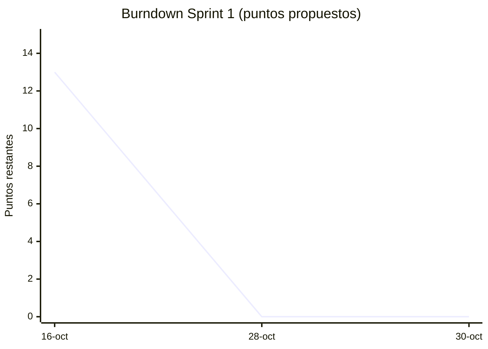

# Sprint 1 — Inicio del recorrido del usuario

[← Volver a la presentación](../readme.md) · [Sprint 2 →](../Sprint_02/readme.md)

> Índice del Sprint 1. Enlaza los documentos que escribió el equipo; no los reemplaza. Los datos que el equipo no registró se indican como tales; las puntuaciones son una propuesta.

## Índice del Sprint 1

### Artefactos de Scrum

| Artefacto | Documento |
|---|---|
| Product Backlog Item (HU del sprint, criterios, estimación) | [1.Product_Backlog_Item](./1.Product_Backlog_Item/readme.md) |
| Sprint Backlog (tareas, responsables, estados) | [5.Tablero_Asignacion_Tareas](./5.Tablero_Asignacion_Tareas/readme.md) · [GitHub Project — vista *Sprint 1*](https://github.com/users/ClxNode/projects/3) |
| Incremento (código) | [6.Repositorio_Codigo](./6.Repositorio_Codigo/readme.md) · [`Codigo_Repositorio/`](../Codigo_Repositorio/readme.md) (llega a `main` con el PR [#35](https://github.com/ClxNode/KuyayPet/pull/35)) |

### Eventos de Scrum

| Evento | Documento |
|---|---|
| Sprint Planning (15-oct) | [2.Sprint_Planning](./2.Sprint_Planning/readme.md) |
| Daily Scrum (15 y 16-oct) | [3.Daily_Scrum](./3.Daily_Scrum/readme.md) · [enlace a Drive del equipo](./7.Pruebas/DailyScrum.md) *(archivo agregado en `main`)* |
| Sprint Retrospective | [4.Sprint_Retrospective](./4.Sprint_Retrospective/readme.md) |
| Sprint Review | [8.Sprint_Review](./8.Sprint_Review/readme.md) |

### Documentos de Ingeniería de Software

| Documento | Enlace |
|---|---|
| Catálogo de las 26 HU | [docs/historias-de-usuario.md](../docs/historias-de-usuario.md) |
| Arquitectura y ADR "sin backend en el MVP" | [docs/arquitectura.md](../docs/arquitectura.md) |
| Modelo entidad-relación (derivado del prototipo) | [docs/modelo-datos.md](../docs/modelo-datos.md) |
| Pruebas y evidencias | [7.Pruebas](./7.Pruebas/readme.md) |
| Cómo trabajamos con GitHub | [CONTRIBUTING.md](../CONTRIBUTING.md) |

## 1. Información general

| Campo | Valor |
|---|---|
| Proyecto | KuyayPet — plataforma de adopción de mascotas |
| Sprint | Sprint 1 — Semana 9 |
| Periodo planificado | 15–16 de octubre de 2026 (milestone [Sprint 1](https://github.com/ClxNode/KuyayPet/milestone/1) vence el 30-oct) |
| Equipo | DevBrad, Dylan Quispe, IchiSieben, Joseph-L-Q, kevinesty, Gael Milla y Juan Vidal |

## 2. Sprint Goal

> Permitir que el usuario inicie el recorrido en KuyayPet: registrarse, consultar mascotas disponibles y revisar el perfil de una mascota.

*(Tomado de [1.Product_Backlog_Item](./1.Product_Backlog_Item/readme.md).)*

## 3. Priorización (MoSCoW)

El equipo priorizó con la prioridad del catálogo (Alta / Media / Baja). La equivalencia MoSCoW de esta tabla es una lectura de esa decisión, no una decisión nueva:

| Ítem | Prioridad del catálogo | MoSCoW | Justificación |
|---|---|---|---|
| HU-01 — Registro de usuario | Alta | Must | Sin cuenta no hay recorrido: es la puerta de entrada de los tres roles |
| HU-02 — Visualización de mascotas disponibles | Alta | Must | Es el valor central del producto: ver qué mascotas buscan hogar |
| HU-03 — Ver perfil de una mascota | Alta | Must | Completa la decisión del adoptante; depende de HU-02 |
| HU-11 — Registrar mascota | Media | Won't (este sprint) | Se reemplazó por datos de prueba identificados como tales ([Planning](./2.Sprint_Planning/readme.md#alcance-y-dependencias)) |
| HU-04 a HU-26 (salvo HU-11) | — | Won't (este sprint) | Fuera del compromiso del Sprint 1 |

## 4. Compromisos del sprint

| HU | Issue | Puntos propuestos* | Tareas | Estado de validación | Evidencia |
|---|---|---|---|---|---|
| HU-01 | [#1](https://github.com/ClxNode/KuyayPet/issues/1) | 5 | [#28](https://github.com/ClxNode/KuyayPet/issues/28), [#29](https://github.com/ClxNode/KuyayPet/issues/29) | Pruebas manuales pendientes · ejecución automatizada 28-oct | [7.Pruebas › HU-01](./7.Pruebas/readme.md#hu-01--registro-de-usuario) |
| HU-02 | [#2](https://github.com/ClxNode/KuyayPet/issues/2) | 5 | [#30](https://github.com/ClxNode/KuyayPet/issues/30), [#31](https://github.com/ClxNode/KuyayPet/issues/31), [#33](https://github.com/ClxNode/KuyayPet/issues/33) | Pruebas manuales pendientes · ejecución automatizada 28-oct con 2 incidencias | [7.Pruebas › HU-02](./7.Pruebas/readme.md#hu-02--pruebas-funcionales-visualización-de-mascotas-disponibles) |
| HU-03 | [#3](https://github.com/ClxNode/KuyayPet/issues/3) | 3 | [#32](https://github.com/ClxNode/KuyayPet/issues/32) ✅, [#33](https://github.com/ClxNode/KuyayPet/issues/33) | Criterios 1-2 aprobados (16-oct) · criterio 3 pendiente (#33) | [7.Pruebas › HU-03](./7.Pruebas/readme.md#hu-03--ver-perfil-de-una-mascota) |
| Coordinación | [#27](https://github.com/ClxNode/KuyayPet/issues/27), [#34](https://github.com/ClxNode/KuyayPet/issues/34) | — | — | Abiertas | — |

\* Los puntos son la propuesta inicial del [Product Backlog Item](./1.Product_Backlog_Item/readme.md#priorización-y-estimación) (13 en total), "pendientes de validar en el Sprint Planning". No hay registro de que se hayan acordado.

> **Implementada ≠ terminada.** Las tres HU están implementadas en el prototipo v0.3, pero una HU solo pasa a *Terminado* con la validación de su responsable y la evidencia en `7.Pruebas`.

## 5. Métricas

### Velocity

| Sprint | Puntos comprometidos | Puntos terminados | Velocity |
|---|---|---|---|
| Sprint 1 | 13 (propuesta) | 13 (propuesta) | 13 |

> Puntos propuestos (HU-01 = 5, HU-02 = 5, HU-03 = 3): el equipo no registró puntos acordados. «Terminado» = issue cerrado en GitHub: #1, #2 y #3 se cerraron el 28-oct-2026 a las 16:37 (hora de Lima). Las pruebas de `7.Pruebas` figuran como Completado.

### Burndown

El equipo no registró puntos restantes por día durante el sprint, así que no hay burndown diario. Con las fechas reales de cierre de los issues (puntos propuestos):

| Fecha (hora de Lima) | Puntos restantes | Hecho registrado |
|---|---|---|
| 16-oct | 13 | Issues #1 a #3 y tareas #27 a #34 creados; la tarea #32 se cerró a las 14:25 |
| 28-oct 16:37 | 0 | Cierre de los issues #1, #2 y #3 |
| 30-oct (vencimiento del milestone) | 0 | — |

La gráfica tiene un solo descenso porque los tres issues se cerraron juntos; no muestra el avance entre ambas fechas.

## 6. Riesgos identificados

Del [Sprint Planning](./2.Sprint_Planning/readme.md#riesgos):

- Acceso de colaboradores con invitación pendiente.
- Disponibilidad de datos de prueba para HU-02 y HU-03.
- Tiempo insuficiente para las tres HU en dos días.

Observado al preparar el cierre (28-oct): el código del prototipo todavía no está en `main` (PR #35 sin fusionar), y la mayoría de las pruebas manuales siguen sin ejecutar.

## 7. Retrospectiva (resumen)

Del [documento de retrospectiva](./4.Sprint_Retrospective/readme.md), marcado por el equipo como propuesta:

- **Salió bien:** HU priorizadas con criterios de aceptación; reparto de responsabilidades.
- **Fue difícil:** accesos a GitHub, dependencia HU-02 → HU-03, estimar el tiempo disponible.
- **Acción de mejora:** confirmar accesos al inicio del sprint y revisar a diario tareas y bloqueos (responsable propuesto: Juan Vidal).

La retrospectiva la escribió el equipo el 16-oct-2026; no se registró otra validación posterior.

## 8. Definition of Done

Del [Sprint Planning](./2.Sprint_Planning/readme.md#definition-of-done-propuesta): una HU se marca *Hecho* únicamente cuando sus criterios de aceptación están implementados y probados, el equipo revisó el resultado y existe evidencia verificable.

## 9. Evidencias

| Evidencia | Dónde |
|---|---|
| Capturas HU-03 (tarea #32) | [7.Pruebas/evidencias/](./7.Pruebas/evidencias/) |
| Capturas HU-01 y HU-02 (ejecución automatizada) | [7.Pruebas/evidencias/HU-01](./7.Pruebas/evidencias/HU-01/) · [HU-02](./7.Pruebas/evidencias/HU-02/) |
| Videos por HU | [HU-01](https://drive.google.com/open?id=1xJK5g8UV8wvEA7DJPV9zvOYEX22ujtx_) · [HU-02](https://drive.google.com/open?id=1CWKeursKtfLnhfWbf_sEeK8czYDKw9YO) · [HU-03](https://drive.google.com/open?id=1LfvP3r7Is-f99a51t3Y5gjA2T5zdG-qJ) |
| Prototipo desplegado | https://firebrick-cod-910257.hostingersite.com/ |
| Video de cierre del sprint | No hay enlace registrado en el repositorio |

## 10. Carryover al Sprint 2

No hay un registro formal de carryover. Las tres HU quedaron en el Sprint 1 (issues #1, #2 y #3 cerrados el 28-oct); su validación y evidencia se completaron en el periodo del Sprint 2: PR #52, #53, #55 y #56 (28-oct), commits del equipo en `7.Pruebas` el 29-oct y PR #67 (12-nov). En `7.Pruebas`, HU-01, HU-02 y HU-03 figuran como Completado. Las tareas #27, #28, #30 y #33 se cerraron el 29-oct a las 00:27 (hora de Lima); #29, el 28-oct a las 23:17; #31 y #34, el 28-oct a las 16:37 y 16:38; #32, el 16-oct.
