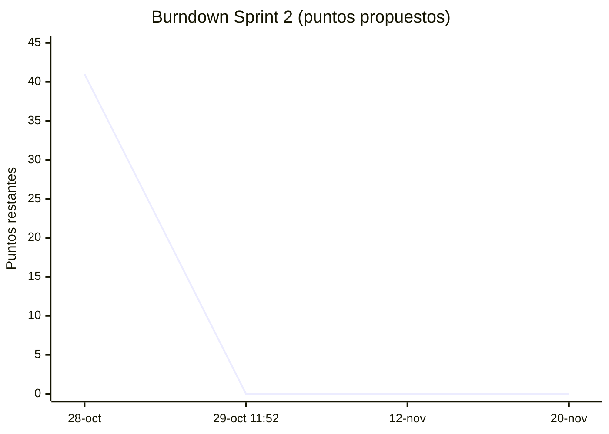

# Sprint 2 — Mascotas: catálogo

[← Sprint 1](../Sprint_01/readme.md) · [Volver a la presentación](../readme.md)

> Índice del Sprint 2, actualizado el 19-nov-2026 con los datos de GitHub (issues, PR, Project y milestone). Los puntos son una propuesta, porque el equipo no los registró; el detalle de cada dato está en el documento enlazado.

## Índice del Sprint 2

### Artefactos de Scrum

| Artefacto | Documento |
|---|---|
| Product Backlog Item (HU del sprint, criterios, puntos propuestos) | [1.Product_Backlog_Item](./1.Product_Backlog_Item/readme.md) |
| Sprint Backlog (tareas #37–#46) | [5.Tablero_Asignacion_Tareas](./5.Tablero_Asignacion_Tareas/readme.md) · [GitHub Project](https://github.com/users/ClxNode/projects/3) |
| Incremento (código, PR, revisores) | [6.Repositorio_Codigo](./6.Repositorio_Codigo/readme.md) · [`Codigo_Repositorio/`](../Codigo_Repositorio/readme.md) |

### Eventos de Scrum

| Evento | Documento |
|---|---|
| Sprint Planning | [2.Sprint_Planning](./2.Sprint_Planning/readme.md) |
| Daily Scrum | [3.Daily_Scrum](./3.Daily_Scrum/readme.md) (bloque del equipo del 28-oct y actividad reconstruida de los días con registro) |
| Sprint Review | [8.Sprint_Review](./8.Sprint_Review/readme.md) |
| Sprint Retrospective | [4.Sprint_Retrospective](./4.Sprint_Retrospective/readme.md) (escrita por el equipo) |

### Documentos de Ingeniería de Software

| Documento | Enlace |
|---|---|
| Arquitectura y ADR | [docs/arquitectura.md](../docs/arquitectura.md) |
| Modelo entidad-relación | [docs/modelo-datos.md](../docs/modelo-datos.md) |
| Plan de pruebas y evidencias | [7.Pruebas](./7.Pruebas/readme.md) |
| Cómo trabajamos con GitHub | [CONTRIBUTING.md](../CONTRIBUTING.md) |

## 1. Información general

| Campo | Valor |
|---|---|
| Sprint | Sprint 2 |
| Inicio | No registrado por el equipo. Primer rastro en GitHub: 28-oct-2026 (tareas #37 a #46 asignadas al milestone a las 10:43, hora de Lima) |
| Cierre | 20-nov-2026 (milestone [Sprint 2](https://github.com/ClxNode/KuyayPet/milestone/2); la Retrospective también dice 20-nov) |
| Equipo | DevBrad (BeyondNate), Dylan Quispe (Dylan200-7), IchiSieben, Joseph-L-Q, kevinesty, Gael Milla (VALTOm07) y Juan Vidal (ClxNode) |
| Historias de usuario | HU-04, HU-05, HU-11, HU-12, HU-16, HU-17, HU-19 y HU-21 (8 HU) |
| Video de cierre del Sprint 1 y planning del Sprint 2 | No hay enlace registrado en el repositorio |
| Videos de evidencia por HU | [Carpeta en Drive](https://drive.google.com/open?id=1e3GcYnJlez_F5GLwqA6CveFjX5wRCiQV) |
| Aplicación desplegada | https://firebrick-cod-910257.hostingersite.com/ |

Fechas y horas en hora de Lima (UTC−5); GitHub las entrega en UTC.

## 2. Continuidad con el Sprint 1

- El prototipo v0.3 entra a `main` con el PR [#35](https://github.com/ClxNode/KuyayPet/pull/35), fusionado el 28-oct-2026 a las 23:11 por ClxNode.
- HU-01, HU-02 y HU-03 quedaron en el Sprint 1 (issues #1 a #3 cerrados el 28-oct a las 16:37). Lo que pasó al Sprint 2 fue su validación y evidencia: PR #52, #53, #55, #56 (28-oct), commits del equipo en `Sprint_01/7.Pruebas` (29-oct) y PR #67 (12-nov). No hay registro de que el equipo decidiera formalmente el carryover ni su motivo.

## 3. Sprint Goal (propuesto)

> **Mascotas — catálogo:** un responsable publica y edita una mascota con fotos, y un adoptante la encuentra con búsqueda, filtros y cercanía, y la guarda en favoritos.

Propuesto en la planning preparada el 28-oct; el equipo no registró un Sprint Goal distinto.

## 4. Priorización MoSCoW (propuesta)

| Ítem | MoSCoW | Justificación |
|---|---|---|
| HU-11 Registrar mascota · HU-16 Fotos y etiquetas · HU-12 Editar · HU-04 Filtros | Must | Núcleo de la rúbrica del Sprint 2 y de su demo |
| HU-05 Cercanía · HU-17 Favoritos | Should | Los pide la rúbrica, pero la demo se sostiene sin ellas |
| HU-19 Marcar como adoptada | Could | Cierra el ciclo de la publicación; la rúbrica no la pide en este sprint |
| HU-21 Cierre seguro de sesión | No clasificada | No figuraba en la planning propuesta; el issue lleva la etiqueta `sprint-2` y su PR #64 se abrió el 28-oct |
| Carryover HU-01..03 | Must (validación) | Compromiso del Sprint 1 pendiente de validar |
| Resto del backlog | Won't (este sprint) | Corresponde al Sprint 3 de la rúbrica |

Detalle en [2.Sprint_Planning](./2.Sprint_Planning/readme.md#hu-candidatas-y-priorización-moscow).

## 5. Compromisos del sprint

Puntos: **propuesta** (el equipo no registró puntos), Fibonacci según el número de criterios del documento del equipo. Responsables: los asignados en el issue de la HU en GitHub.

| HU | Issue | Puntos (propuesta) | Tarea | Responsable (GitHub) | Estado en el Project | Evidencia |
|---|---|---|---|---|---|---|
| HU-11 | [#11](https://github.com/ClxNode/KuyayPet/issues/11) | 5 | [#38](https://github.com/ClxNode/KuyayPet/issues/38) | Dylan200-7 | Terminado | [7.Pruebas › HU-11](./7.Pruebas/readme.md#hu-11--registrar-mascota) |
| HU-16 | [#16](https://github.com/ClxNode/KuyayPet/issues/16) | 5 | [#39](https://github.com/ClxNode/KuyayPet/issues/39) | ClxNode, Dylan200-7 | Terminado | [7.Pruebas › HU-16](./7.Pruebas/readme.md#hu-16--registro-visual-y-etiquetado-de-mascotas) |
| HU-12 | [#12](https://github.com/ClxNode/KuyayPet/issues/12) | 3 | [#40](https://github.com/ClxNode/KuyayPet/issues/40) | ClxNode, Dylan200-7 | Terminado | [7.Pruebas › HU-12](./7.Pruebas/readme.md#hu-12--editar-información-textual-de-una-mascota) |
| HU-04 | [#4](https://github.com/ClxNode/KuyayPet/issues/4) | 8 | [#41](https://github.com/ClxNode/KuyayPet/issues/41) | VALTOm07 | Terminado | [7.Pruebas › HU-04](./7.Pruebas/readme.md#hu-04--filtrar-mascotas-según-preferencias) |
| HU-05 | [#5](https://github.com/ClxNode/KuyayPet/issues/5) | 5 | [#42](https://github.com/ClxNode/KuyayPet/issues/42) | VALTOm07, kevinesty | Terminado | [7.Pruebas › HU-05](./7.Pruebas/readme.md#hu-05--búsqueda-de-mascotas-cercanas) |
| HU-17 | [#17](https://github.com/ClxNode/KuyayPet/issues/17) | 5 | [#43](https://github.com/ClxNode/KuyayPet/issues/43) | Joseph-L-Q | Terminado | [7.Pruebas › HU-17](./7.Pruebas/readme.md#hu-17--guardado-de-mascotas-favoritas) |
| HU-19 | [#19](https://github.com/ClxNode/KuyayPet/issues/19) | 5 | [#44](https://github.com/ClxNode/KuyayPet/issues/44) | BeyondNate, Joseph-L-Q | Terminado | [7.Pruebas › HU-19](./7.Pruebas/readme.md#hu-19--actualización-de-mascota-como-adoptada) |
| HU-21 | [#21](https://github.com/ClxNode/KuyayPet/issues/21) | 5 | sin tarea | ClxNode | Terminado | [7.Pruebas › HU-21](./7.Pruebas/readme.md#hu-21--cierre-seguro-de-sesión-capturas-por-criterio) |

HU-13 (3 puntos) tiene la etiqueta `sprint-2`, pero se probó y entregó en el Sprint 3 (PR #73); no se cuenta aquí.

## 6. Métricas

Todos los puntos son una **propuesta** (regla y valores por HU en [1.Product_Backlog_Item](./1.Product_Backlog_Item/readme.md)). «Terminado» significa issue cerrado en GitHub.

### Velocity

| Sprint | Puntos comprometidos | Puntos terminados | Velocity |
|---|---|---|---|
| Sprint 1 (HU-01, 02, 03) | 13 | 13 | 13 |
| Sprint 2 (8 HU) | 41 (36 de las 7 HU de la planning propuesta + 5 de HU-21) | 41 | 41 |

Las 8 HU tienen el issue cerrado el 29-oct-2026 (11:51 a 11:52). La validación manual de los responsables sigue pendiente (casilla por HU en 7.Pruebas); si no se cuenta como terminado lo no validado, la velocity sería 0, porque ninguna casilla está marcada.

### Burndown (fechas reales de cierre de los issues)

| Fecha | Puntos restantes | Hecho registrado |
|---|---|---|
| 28-oct (primer registro del sprint) | 41 | Tareas #37 a #46 en el milestone; 20 PR abiertos por IchiSieben entre las 10:50 y las 22:27 |
| 28-oct 23:11 a 29-oct 00:14 | 41 | PR #35 y #47 a #66 fusionados (cuentan como trabajo, no como HU cerrada) |
| 29-oct 11:52 | 0 | Cierre de los issues de HU-04, 05, 11, 12, 16, 17, 19 y 21 |
| 12-nov | 0 | Cierre de las tareas #45 y #46 |
| 20-nov (cierre del milestone) | 0 | Tareas #37 a #44 siguen abiertas en GitHub |

El descenso es de un solo escalón porque los issues se cerraron juntos, en un minuto; la gráfica no refleja el avance diario real, que GitHub no registra.

## 7. Riesgos

Ver [2.Sprint_Planning › Riesgos](./2.Sprint_Planning/readme.md#riesgos). El principal: **el curso tiene 3 sprints**; lo pendiente (HU-06 a HU-10, 13, 14, 15, 18, 20, 22 a 26) se concentra en el Sprint 3, que vence el 27-nov, una semana después del cierre de este.

## 8. Retrospectiva (resumen)

Escrita por el equipo: [4.Sprint_Retrospective](./4.Sprint_Retrospective/readme.md). En resumen, el equipo señala como logros el avance del catálogo (registro, edición, fotos, filtros y favoritos), las pruebas funcionales, las evidencias y el uso de issues y PR; como dificultades, la coordinación de PR y la validación de criterios; y como compromisos, definir responsabilidades al inicio, registrar evidencias a medida que se completan las pruebas y revisar los PR a tiempo.

## 9. Definition of Done

Una HU se marca *Terminado* solo cuando sus criterios de aceptación están implementados y probados, su responsable la validó, la evidencia está en `Sprint_02/7.Pruebas/evidencias/HU-NN/` y el equipo revisó el resultado.

Estado al 19-nov: criterios probados con ejecución automatizada y evidencia en `7.Pruebas`; validación de los responsables pendiente.

## 10. Evidencias

| Evidencia | Dónde |
|---|---|
| Capturas por HU | [7.Pruebas/evidencias/](./7.Pruebas/evidencias/) |
| Videos por HU | [Carpeta en Drive](https://drive.google.com/open?id=1e3GcYnJlez_F5GLwqA6CveFjX5wRCiQV) y enlace por HU en [7.Pruebas](./7.Pruebas/readme.md) |
| Demo «un responsable publica y otro usuario la encuentra» | Tarea [#46](https://github.com/ClxNode/KuyayPet/issues/46) (cerrada el 12-nov). No hay un video propio de la demo en el repositorio; ver [8.Sprint_Review](./8.Sprint_Review/readme.md) |
