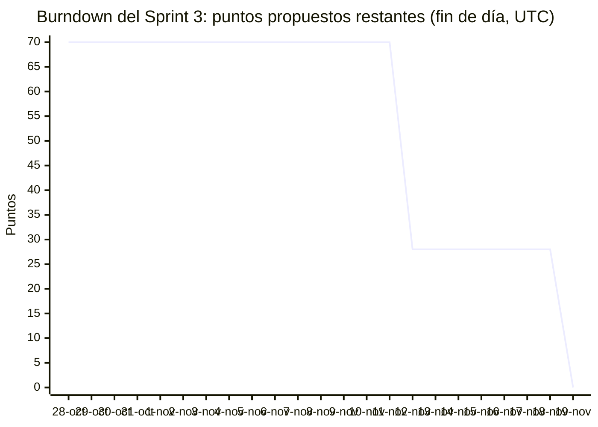

# Sprint 3 — Adopción y cierre del producto

[← Sprint 2](../Sprint_02/readme.md) · [Volver a la presentación](../readme.md)

> Reconstruido a partir del historial de GitHub el 2026-11-19; el equipo puede corregirlo.

> Índice del Sprint 3. Los documentos que el equipo no escribió (Daily, Retrospectiva, Tablero) están reconstruidos con datos de GitHub y se marcan como tales. Los puntos son una **propuesta**: el equipo no los registró.

El Sprint 3 es el último del curso (3 sprints) y tiene dos partes: **(a) adopción** (HU-06, 07, 08, 09, 10, 13, 18, 20) y **(b) administración y cierre** (HU-14, 15, 22, 23, 24, 25, 26, pruebas de seguridad, manual de usuario, documentación técnica, despliegue y cierre del proyecto). La parte (a) se presentó el 12-nov; la parte (b) se completó el 19-nov-2026, cuando el equipo fusionó sus PR de código, evidencias y pruebas de seguridad (el milestone vence el 27-nov).

## Índice del Sprint 3

### Artefactos de Scrum

| Artefacto | Documento |
|---|---|
| Product Backlog Item (15 HU, criterios completos) | [1.Product_Backlog_Item](./1.Product_Backlog_Item/readme.md) |
| Sprint Backlog (tareas #77–#87 y HU) | [5.Tablero_Asignacion_Tareas](./5.Tablero_Asignacion_Tareas/readme.md) · [GitHub Project](https://github.com/users/ClxNode/projects/3) |
| Incremento (código y PR) | [6.Repositorio_Codigo](./6.Repositorio_Codigo/readme.md) · [`Codigo_Repositorio/`](../Codigo_Repositorio/readme.md) |

### Eventos de Scrum

| Evento | Documento |
|---|---|
| Sprint Planning | [2.Sprint_Planning](./2.Sprint_Planning/readme.md) |
| Daily Scrum | [3.Daily_Scrum](./3.Daily_Scrum/readme.md) — reconstruido |
| Sprint Review | [8.Sprint_Review](./8.Sprint_Review/readme.md) |
| Sprint Retrospective | [4.Sprint_Retrospective](./4.Sprint_Retrospective/readme.md) — reconstruida |

### Documentos de Ingeniería de Software

| Documento | Enlace |
|---|---|
| Arquitectura y ADR | [docs/arquitectura.md](../docs/arquitectura.md) |
| Modelo entidad-relación | [docs/modelo-datos.md](../docs/modelo-datos.md) |
| Plan de pruebas y evidencias | [7.Pruebas](./7.Pruebas/readme.md) |
| Cómo trabajamos con GitHub | [CONTRIBUTING.md](../CONTRIBUTING.md) |
| Entregables de la parte (b) | [manual de usuario](../docs/manual-usuario.md) · [documentación técnica](../docs/documentacion-tecnica.md) · [despliegue](../docs/despliegue.md) · [pruebas](../docs/pruebas.md) · [cierre del proyecto](../docs/cierre-proyecto.md) |

## 1. Información general

| Campo | Valor |
|---|---|
| Sprint | Sprint 3 — Adopción y cierre del producto |
| Milestone | [Sprint 3](https://github.com/ClxNode/KuyayPet/milestone/3): creado el 16-oct-2026, vence el **27-nov-2026** (API de GitHub) |
| Primera actividad | 28-oct-2026 17:21Z: commit `48c6df7` en la rama `sprint-3/HU-06-criterios` (git) |
| Issue de planificación | [#77](https://github.com/ClxNode/KuyayPet/issues/77), creado el 12-nov-2026 16:19Z |
| Exposición | 12-nov-2026, parte (a). Fecha recibida en el encargo de cierre; el repositorio no la registra |
| Parte (a) cerrada en GitHub | 12-nov-2026 23:55:40Z (último issue, HU-20) |
| Parte (b) | PR [#88](https://github.com/ClxNode/KuyayPet/pull/88)–[#95](https://github.com/ClxNode/KuyayPet/pull/95) abiertos el 19-nov-2026 15:33–15:34Z y fusionados el 19-nov entre las 16:26Z y las 16:47Z; pruebas de seguridad (#99) fusionadas a las 16:48Z |
| Equipo | DevBrad, Dylan Quispe, IchiSieben, Joseph-L-Q, kevinesty, Gael Milla y Juan Vidal (cuentas de GitHub: IchiSieben, VALTOm07, kevinesty, BeyondNate, ClxNode, Joseph-L-Q, Dylan200-7) |
| Video de cierre del Sprint 2 y planning del Sprint 3 | No registrado en el repositorio |

Las horas están en UTC (hora de Lima = UTC−5).

## 2. Continuidad con el Sprint 2

- El [Sprint 2](../Sprint_02/readme.md) cerró el catálogo (registro, edición y fotos de mascotas, filtros, cercanía y favoritos). Sus 8 HU se cerraron en GitHub el 29-oct. Sobre ese catálogo se construye el contacto entre adoptantes y responsables.
- HU-13 tiene la etiqueta `sprint-2` en GitHub, pero se probó y se entregó en este sprint (PR [#73](https://github.com/ClxNode/KuyayPet/pull/73)); se cuenta aquí.
- Las pantallas de las 15 HU ya existían en `main` desde el 16-oct (prototipo v0.3, commit `f7c8312`). El trabajo de este sprint es verificarlas contra sus criterios (tests, evidencias) y corregir lo que no cumplía.

## 3. Sprint Goal

> **Adopción y cierre del producto.** (a) *Adopción:* un adoptante indica interés en una mascota (“Me gusta”) o propone coordinar su adopción; el responsable recibe la notificación y responde; si acepta el interés se genera el Match y se habilita el chat; el adoptante consulta sus matches y su historial. (b) *Administración y cierre:* el administrador gestiona usuarios, publicaciones y reportes; el usuario consulta la guía de adopción y recupera su contraseña; el producto cierra con pruebas de seguridad, manual de usuario, documentación técnica, despliegue y cierre del proyecto.

## 4. Priorización MoSCoW (propuesta)

| Ítem | MoSCoW | Justificación |
|---|---|---|
| (a) HU-06, HU-07, HU-08, HU-10, HU-13 | Must | Forman el flujo central: interés → notificación → respuesta del responsable → Match → chat |
| (b) HU-15, HU-22, HU-23, HU-24 | Must | La rúbrica de cierre pide recuperación de contraseña, administración y moderación; HU-24 condiciona qué mascotas ven los adoptantes |
| (a) HU-18, HU-20 · (b) HU-25, HU-26 | Should | Piden la rúbrica o completan el flujo, pero el flujo principal funciona sin ellas |
| (a) HU-09 · (b) HU-14 | Could | Prioridad Baja en el catálogo; independientes del flujo principal |
| Pruebas de seguridad, manual de usuario, documentación técnica, despliegue, cierre del proyecto | Must | Entregables de cierre de la rúbrica (sin puntos: no son HU) |

Detalle, dependencias y riesgos: [2.Sprint_Planning](./2.Sprint_Planning/readme.md).

## 5. Compromisos del sprint

Puntos: **propuesta** (regla en la sección 6). Responsable = asignado del issue en GitHub; `por asignar` si no hay.

| HU | Issue | Puntos | Tarea | Responsable | Cierre del issue | PR | Estado | Evidencia |
|---|---|---|---|---|---|---|---|---|
| (a) HU-06 | [#6](https://github.com/ClxNode/KuyayPet/issues/6) | 3 | [#78](https://github.com/ClxNode/KuyayPet/issues/78) | ClxNode | 12-nov 20:05:41Z por ClxNode | [#68](https://github.com/ClxNode/KuyayPet/pull/68) | Issue cerrado; PR fusionado; validación pendiente | [7.Pruebas](./7.Pruebas/readme.md#hu-06--indicar-interés-en-una-mascota) |
| (a) HU-07 | [#7](https://github.com/ClxNode/KuyayPet/issues/7) | 8 | [#79](https://github.com/ClxNode/KuyayPet/issues/79) | ClxNode | 12-nov 20:07:45Z por ClxNode | [#69](https://github.com/ClxNode/KuyayPet/pull/69) | Issue cerrado; PR fusionado; validación pendiente | [7.Pruebas](./7.Pruebas/readme.md#hu-07--recibir-un-match-por-compatibilidad) |
| (a) HU-08 | [#8](https://github.com/ClxNode/KuyayPet/issues/8) | 8 | [#80](https://github.com/ClxNode/KuyayPet/issues/80) | por asignar | 12-nov 20:11:09Z por ClxNode | [#70](https://github.com/ClxNode/KuyayPet/pull/70) | Issue cerrado; PR fusionado; validación pendiente | [7.Pruebas](./7.Pruebas/readme.md#hu-08--comunicarse-con-el-responsable) |
| (a) HU-09 | [#9](https://github.com/ClxNode/KuyayPet/issues/9) | 5 | [#81](https://github.com/ClxNode/KuyayPet/issues/81) | por asignar | 12-nov 20:11:10Z por ClxNode | [#71](https://github.com/ClxNode/KuyayPet/pull/71) | Issue cerrado; PR fusionado; validación pendiente | [7.Pruebas](./7.Pruebas/readme.md#hu-09--chat-entre-usuarios-interesados) |
| (a) HU-10 | [#10](https://github.com/ClxNode/KuyayPet/issues/10) | 5 | [#82](https://github.com/ClxNode/KuyayPet/issues/82) | por asignar | 12-nov 20:11:12Z por ClxNode | [#72](https://github.com/ClxNode/KuyayPet/pull/72) | Issue cerrado; PR fusionado; validación pendiente | [7.Pruebas](./7.Pruebas/readme.md#hu-10--coordinar-posible-adopción) |
| (a) HU-13 | [#13](https://github.com/ClxNode/KuyayPet/issues/13) | 3 | [#83](https://github.com/ClxNode/KuyayPet/issues/83) | IchiSieben | 29-oct 16:52:00Z por ClxNode | [#73](https://github.com/ClxNode/KuyayPet/pull/73) | Issue cerrado; PR fusionado; validación pendiente | [7.Pruebas](./7.Pruebas/readme.md#hu-13--notificación-de-interés-en-mascota) |
| (a) HU-18 | [#18](https://github.com/ClxNode/KuyayPet/issues/18) | 5 | [#84](https://github.com/ClxNode/KuyayPet/issues/84) | por asignar | 12-nov 23:55:39Z por ClxNode | [#74](https://github.com/ClxNode/KuyayPet/pull/74) | Issue cerrado; PR fusionado; validación pendiente | [7.Pruebas](./7.Pruebas/readme.md#hu-18--historial-de-mascotas-de-interés) |
| (a) HU-20 | [#20](https://github.com/ClxNode/KuyayPet/issues/20) | 5 | [#85](https://github.com/ClxNode/KuyayPet/issues/85) | por asignar | 12-nov 23:55:40Z por ClxNode | [#75](https://github.com/ClxNode/KuyayPet/pull/75) | Issue cerrado; PR fusionado; validación pendiente | [7.Pruebas](./7.Pruebas/readme.md#hu-20--visualización-de-compatibilidades) |
| (b) HU-14 | [#14](https://github.com/ClxNode/KuyayPet/issues/14) | 2 | — | por asignar | 12-nov 23:55:36Z por ClxNode | [#88](https://github.com/ClxNode/KuyayPet/pull/88) | Issue cerrado; PR fusionado 19-nov 16:26Z; validación pendiente | [7.Pruebas › parte (b)](./7.Pruebas/readme.md#parte-b-administración-y-cierre) |
| (b) HU-15 | [#15](https://github.com/ClxNode/KuyayPet/issues/15) | 3 | — | por asignar | 12-nov 23:55:39Z por ClxNode | [#89](https://github.com/ClxNode/KuyayPet/pull/89) | Issue cerrado; PR fusionado 19-nov 16:33Z; validación pendiente | [7.Pruebas › parte (b)](./7.Pruebas/readme.md#parte-b-administración-y-cierre) |
| (b) HU-22 | [#22](https://github.com/ClxNode/KuyayPet/issues/22) | 5 | — | por asignar | 12-nov 23:55:41Z por ClxNode | [#90](https://github.com/ClxNode/KuyayPet/pull/90) | Issue cerrado; PR fusionado 19-nov 16:37Z; validación pendiente | [7.Pruebas › parte (b)](./7.Pruebas/readme.md#parte-b-administración-y-cierre) |
| (b) HU-23 | [#23](https://github.com/ClxNode/KuyayPet/issues/23) | 5 | — | por asignar | 12-nov 23:55:41Z por ClxNode | [#91](https://github.com/ClxNode/KuyayPet/pull/91) | Issue cerrado; PR fusionado 19-nov 16:38Z; validación pendiente | [7.Pruebas › parte (b)](./7.Pruebas/readme.md#parte-b-administración-y-cierre) |
| (b) HU-24 | [#24](https://github.com/ClxNode/KuyayPet/issues/24) | 5 | — | por asignar | 12-nov 23:55:42Z por ClxNode | [#92](https://github.com/ClxNode/KuyayPet/pull/92) | Issue cerrado; PR fusionado 19-nov 16:40Z; validación pendiente | [7.Pruebas › parte (b)](./7.Pruebas/readme.md#parte-b-administración-y-cierre) |
| (b) HU-25 | [#25](https://github.com/ClxNode/KuyayPet/issues/25) | 5 | — | por asignar | 12-nov 23:55:43Z por ClxNode | [#93](https://github.com/ClxNode/KuyayPet/pull/93) | Issue cerrado; PR fusionado 19-nov 16:40Z; validación pendiente | [7.Pruebas › parte (b)](./7.Pruebas/readme.md#parte-b-administración-y-cierre) |
| (b) HU-26 | [#26](https://github.com/ClxNode/KuyayPet/issues/26) | 3 | — | por asignar | 12-nov 23:55:44Z por ClxNode | [#94](https://github.com/ClxNode/KuyayPet/pull/94) | Issue cerrado; PR fusionado 19-nov 16:41Z; validación pendiente | [7.Pruebas › parte (b)](./7.Pruebas/readme.md#parte-b-administración-y-cierre) |

Tareas generales: [#77](https://github.com/ClxNode/KuyayPet/issues/77) (alcance y estimaciones), [#86](https://github.com/ClxNode/KuyayPet/issues/86) (adaptación a computadora y móvil) y [#87](https://github.com/ClxNode/KuyayPet/issues/87) (demo), cerradas el 12-nov 19:35Z. Para la parte (b) no hay issues de tarea; el trabajo está en los PR.

## 6. Métricas

**Regla de puntos (propuesta, no registrada por el equipo):** Fibonacci por número de criterios del documento del equipo — ≤4: 2 · 5: 3 · 6–7: 5 · ≥8: 8 — y un escalón más cuando hay complejidad técnica extra. HU-26 cuenta los 2 criterios de su issue (no está en el PDF).

**Definición de “terminada” usada aquí:** el issue de la HU está cerrado en GitHub **y** su PR de criterios está fusionado en `main` (se toma el más tardío de los dos). La casilla “Validado por” de cada HU en [7.Pruebas](./7.Pruebas/readme.md) sigue sin marcar.

### Velocity

| Sprint | Puntos comprometidos | Puntos terminados | Velocity |
|---|---|---|---|
| Sprint 1 | 13 | 13 (issues #1, #2, #3 cerrados el 28-oct) | 13 |
| Sprint 2 | 41 | 41 (8 issues cerrados el 29-oct) | 41 |
| Sprint 3 | 70 (42 parte a + 28 parte b) | 70 (42 parte a al 12-nov + 28 parte b al 19-nov) | **70 de 70 puntos propuestos** |

### Burndown

| Fecha y hora (UTC) | Evento | HU | Puntos | Restantes |
|---|---|---|---|---|
| 28-oct 17:21:48Z | Primera actividad del sprint (commit `48c6df7`, HU-06) | — | — | 70 |
| 29-oct 16:52:00Z | Issue #13 cerrado; su PR #73 sigue abierto, no se descuenta | HU-13 | — | 70 |
| 12-nov 16:51:33Z | PR #73 fusionado (el issue ya estaba cerrado desde el 29-oct) | HU-13 | −3 | 67 |
| 12-nov 20:05:41Z | issue #6 cerrado | HU-06 | −3 | 64 |
| 12-nov 20:07:45Z | issue #7 cerrado | HU-07 | −8 | 56 |
| 12-nov 20:11:09Z | issue #8 cerrado | HU-08 | −8 | 48 |
| 12-nov 20:11:10Z | issue #9 cerrado | HU-09 | −5 | 43 |
| 12-nov 20:11:12Z | issue #10 cerrado | HU-10 | −5 | 38 |
| 12-nov 23:55:39Z | issue #18 cerrado | HU-18 | −5 | 33 |
| 12-nov 23:55:40Z | issue #20 cerrado | HU-20 | −5 | 28 |
| 13-nov a 18-nov | Sin eventos de cierre; parte (b) con issues cerrados el 12-nov y PR #88–#95 aún sin fusionar | HU-14, 15, 22–26 | — | 28 |
| 19-nov 16:26:16Z | PR #88 fusionado por BeyondNate | HU-14 | −2 | 26 |
| 19-nov 16:33:56Z | PR #89 fusionado por Dylan200-7 | HU-15 | −3 | 23 |
| 19-nov 16:37:58Z | PR #90 fusionado por BeyondNate | HU-22 | −5 | 18 |
| 19-nov 16:38:29Z | PR #91 fusionado por kevinesty | HU-23 | −5 | 13 |
| 19-nov 16:40:06Z | PR #92 fusionado por VALTOm07 | HU-24 | −5 | 8 |
| 19-nov 16:40:46Z | PR #93 fusionado por ClxNode | HU-25 | −5 | 3 |
| 19-nov 16:41:21Z | PR #94 fusionado por BeyondNate | HU-26 | −3 | 0 |

Notas: (1) HU-13 se descuenta el 12-nov y no el 29-oct porque su PR de criterios se fusionó recién ese día. (2) Si se contara solo el cierre del issue, la parte (b) llegaría a 0 el 12-nov 23:55Z; se usa el merge del PR porque la definición de “terminada” lo exige, y por eso la parte (b) llega a 0 el 19-nov. (3) El burndown de Sprint 1 y Sprint 2 no se reconstruye aquí.

## 7. Riesgos

Ver [2.Sprint_Planning › Riesgos](./2.Sprint_Planning/readme.md#riesgos). Principales: la validación manual de las 15 HU no está registrada; el chat y las respuestas del responsable son simulados (los datos viven en el navegador).

## 8. Retrospectiva (resumen)

Reconstruida, parte (a) completa y parte (b) con datos al 19-nov: [4.Sprint_Retrospective](./4.Sprint_Retrospective/readme.md). Resumen de hechos: los 9 PR de la parte (a) se fusionaron el 12-nov, día de la exposición; el 19-nov el equipo revisó y fusionó los 9 PR de la parte (b) entre las 16:26 y las 16:48 UTC; 5 de 8 HU y 9 de 11 tareas no tienen responsable asignado; la carpeta `Sprint_03` estaba vacía al fusionarse esos PR.

## 9. Definition of Done

Una HU se marca *Terminada* solo cuando sus criterios de aceptación están implementados y probados, su responsable la validó, la evidencia está en `Sprint_03/7.Pruebas/evidencias/HU-NN/` y el equipo revisó el resultado. Estado al 19-nov: parte (a) con criterios probados y evidencia fusionada; validación del responsable pendiente en las 15 HU; parte (b) con PR fusionados el 19-nov (los de código, #88–#94, y las evidencias, #95).

## 10. Evidencias

| Evidencia | Dónde |
|---|---|
| Parte (a): 55 criterios con captura y 8 videos (ejecución automatizada del 28-oct) | [7.Pruebas](./7.Pruebas/readme.md) · [carpeta de videos en Drive](https://drive.google.com/open?id=1e3GcYnJlez_F5GLwqA6CveFjX5wRCiQV) |
| Parte (b): evidencias en el PR [#95](https://github.com/ClxNode/KuyayPet/pull/95) (fusionado el 19-nov 16:47:57Z) | [7.Pruebas › parte (b)](./7.Pruebas/readme.md#parte-b-administración-y-cierre) |
| Sprint Review | [8.Sprint_Review](./8.Sprint_Review/readme.md) |
