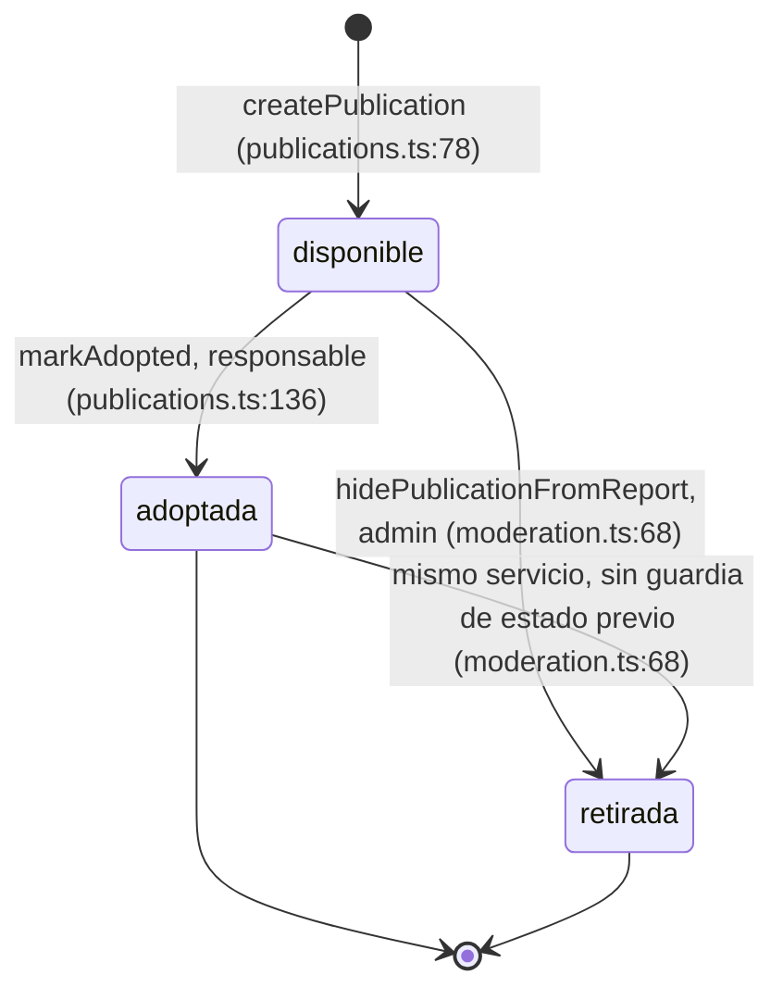
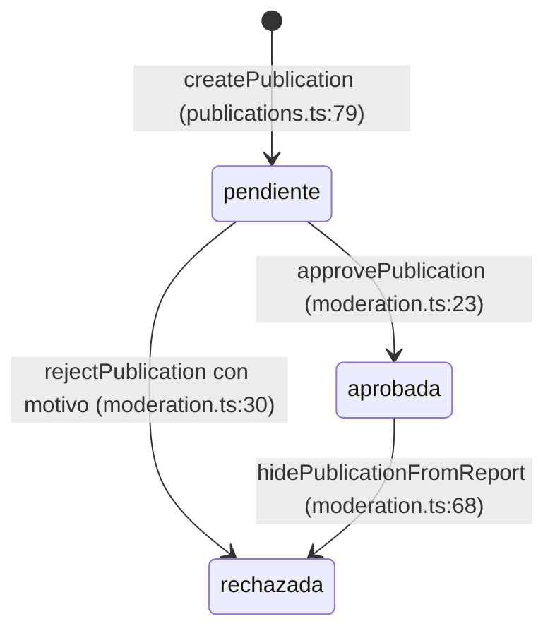
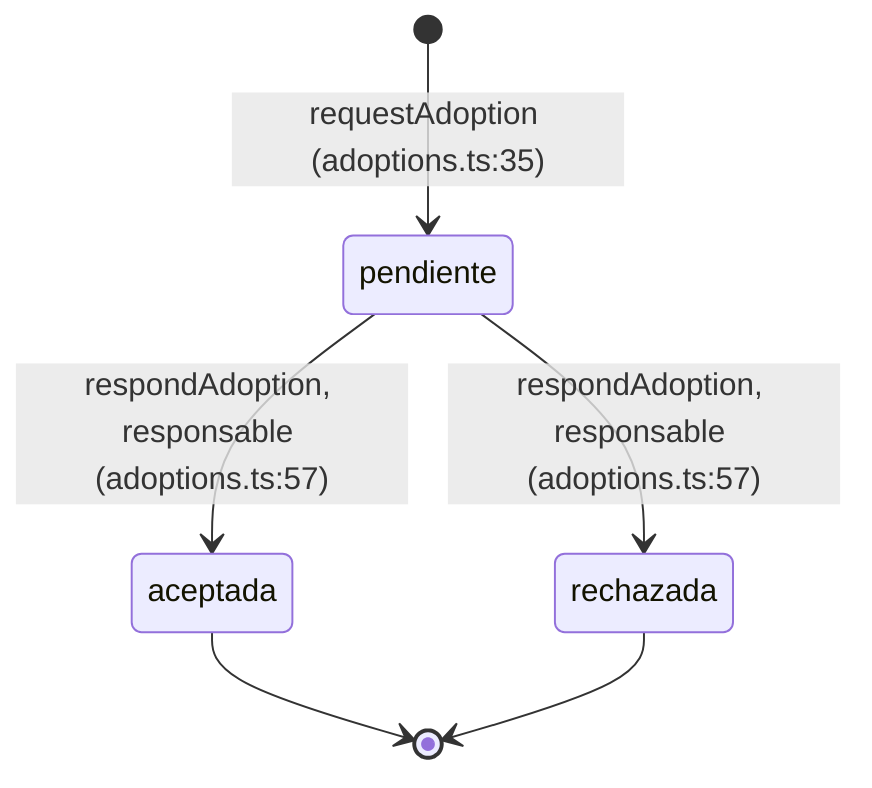
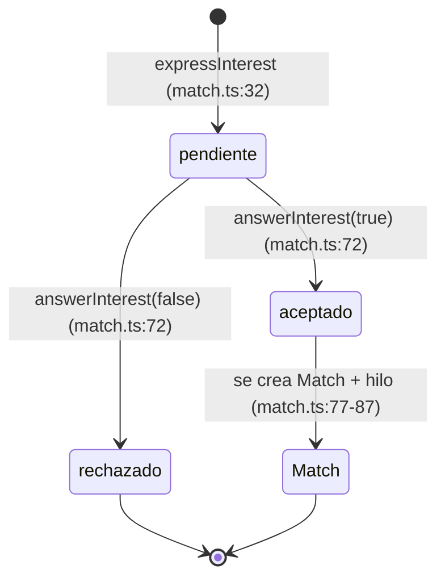
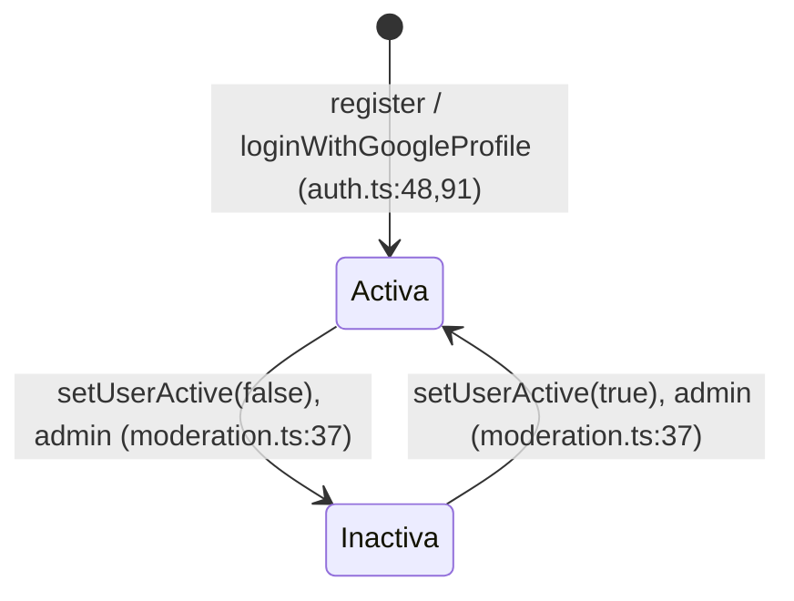
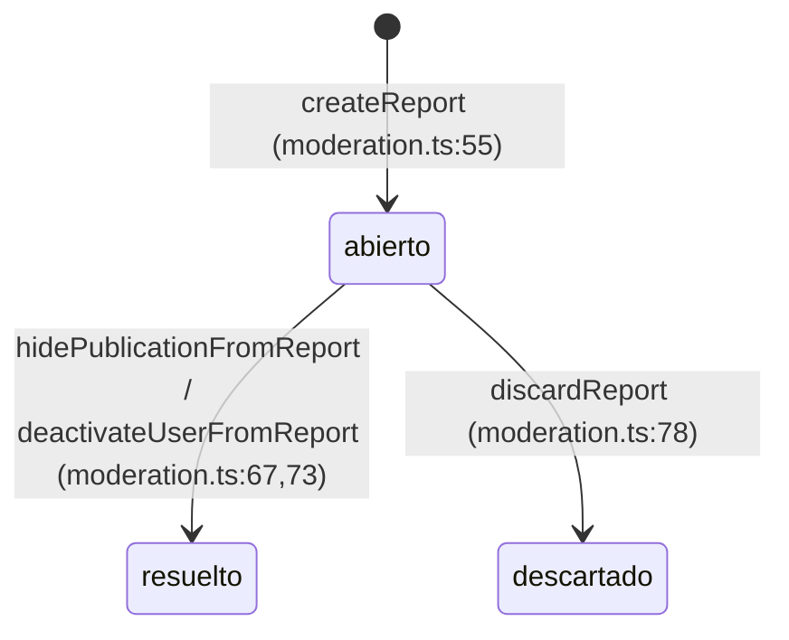
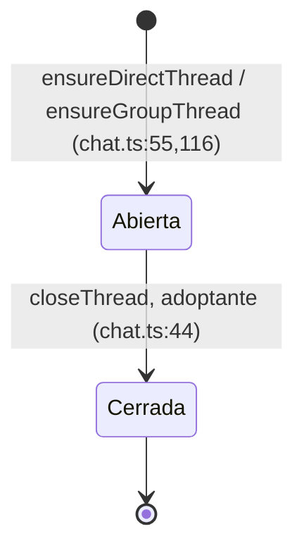
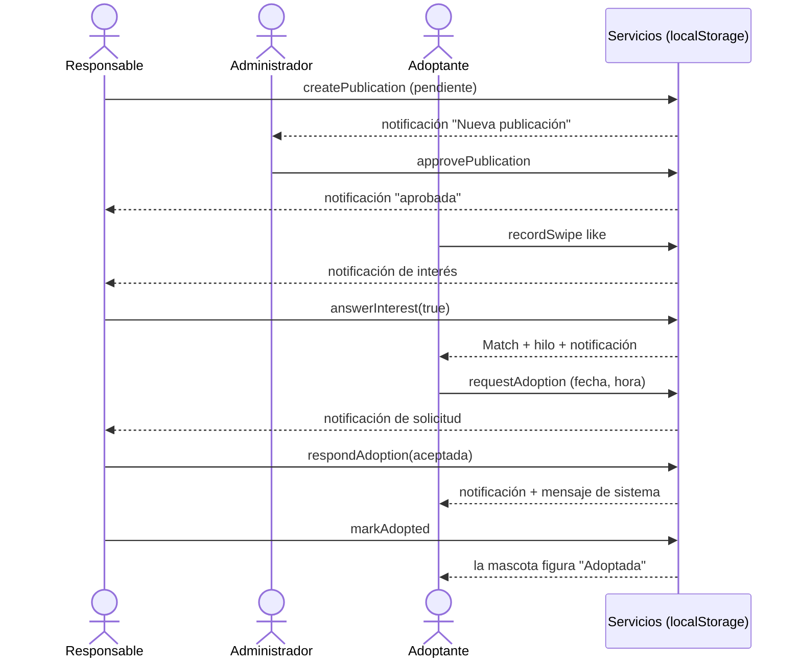

# Análisis del sistema — KuyayPet

[← Volver a la presentación](../readme.md) · [Arquitectura](./arquitectura.md) · [Modelo de datos](./modelo-datos.md) · [Catálogo de HU](./historias-de-usuario.md)

> Este análisis describe el comportamiento **real** del prototipo en `main` (commit `8973b20`), leído del código de [`Codigo_Repositorio/kuyaypet-web/src/`](../Codigo_Repositorio/kuyaypet-web/src/) y contrastado con los criterios de aceptación de la lista de historias de usuario del equipo (copiada en [historias-de-usuario.md](./historias-de-usuario.md)). Lo que el código no hace se marca como tal.
>
> **Citas.** Toda cita `archivo:línea` es relativa a `Codigo_Repositorio/kuyaypet-web/src/`. Las líneas corresponden a `main`. Tres PR de código de la parte (b) del Sprint 3 siguen abiertos y modifican pantallas citadas aquí: #88 (HU-14, acceso a la guía desde `shell/AppLayout.tsx`), #91 (HU-23, el detalle de la publicación muestra los datos de la mascota, `screens/admin/AdminPublicationDetail.tsx`) y #93 (HU-25, aviso "La cuenta ya está inactiva" en `screens/admin/AdminUserDetail.tsx`). Cuando se fusionen, esas líneas se desplazan; las reglas no cambian.
>
> **Criterios de HU-26.** El PDF fuente no incluye la sección HU-26; sus dos criterios salen del issue #26 (ver `kuyaypet-tools/AUDITORIA_CRITERIOS.md`, línea 7).

## 1. Propósito y alcance del análisis

**Propósito.** Dejar por escrito qué actores usan KuyayPet, qué puede hacer cada uno, qué reglas de negocio se desprenden de los criterios de aceptación, qué estados recorre cada entidad y dónde se hace cumplir cada regla en el código. Sirve para que el profesor y el equipo comprueben que las 26 HU tienen una regla verificable y para dejar explícito qué controles son solo de interfaz.

**Alcance.**

- Incluye: roles y permisos, reglas de negocio, estados y transiciones, flujos entre roles (adopción y moderación) y riesgos del prototipo.
- No repite: la estructura técnica ([arquitectura](./arquitectura.md)), las entidades y relaciones ([modelo de datos](./modelo-datos.md)) ni el catálogo de HU ([historias de usuario](./historias-de-usuario.md)).
- Fuera de alcance: diseño de una futura API o base de datos (solo se mencionan las mitigaciones en la sección 6) y las pruebas automatizadas (ver `kuyaypet-tools/AUDITORIA_CRITERIOS.md`).

**Método.** Cada regla se rastreó desde un criterio de aceptación hasta la línea de código que la aplica. Se distinguen tres niveles de aplicación:

| Nivel | Significado |
|---|---|
| **Ruta** | `RequireAuth` y `canAccess` impiden abrir la pantalla (`shell/RequireAuth.tsx:44-45`, `services/auth.ts:197-207`). Se evita desde el navegador, pero el control corre en el cliente. |
| **Servicio** | La función de `services/*` valida y rechaza. Es la capa donde se debería concentrar la regla (ADR-K01 en [arquitectura](./arquitectura.md)). |
| **Solo UI** | La pantalla oculta o deshabilita el botón, pero el servicio ejecutaría la acción si se lo llama. |

## 2. Actores, roles y permisos

### 2.1 Actores

| Actor | Rol en código | Cómo se obtiene | Fuente |
|---|---|---|---|
| **Visitante sin sesión** | — (`sessionUserId = null`) | Estado inicial antes de iniciar sesión. | `services/store.ts:29`, `shell/RequireAuth.tsx:44` |
| **Adoptante** | `adopter` | Único rol que se crea por registro (`role: 'adopter'`, también con Google). | `types/index.ts:4`, `services/auth.ts:43`, `services/auth.ts:87` |
| **Responsable de mascota** (persona o albergue) | `owner` | Solo existe por la semilla de datos; no hay pantalla para convertirse en responsable. | `data/seed/users.json`, `types/index.ts:63-64` |
| **Administrador** | `admin` | Solo por la semilla; no hay alta de administradores. | `data/seed/users.json`, `services/auth.ts:5` |

La lista de HU habla además de "usuario común" (HU-01, 09, 14, 15, 21): en el código no es un rol, sino cualquier rol con sesión (HU-01, 14, 15 y 21 además se pueden usar sin sesión o antes de tenerla; ver matriz).

Las rutas públicas son `/`, `/login`, `/registro`, `/recuperar`, `/creditos` y `/guia` (`App.tsx:105-110`). Todo lo demás cuelga de `RequireAuth` (`App.tsx:111`).

### 2.2 Matriz rol × acción

Leyenda: **Sí** = permitido, **—** = no permitido, **Parcial** = permitido con condición. La columna "Cómo se hace cumplir" indica el nivel real (sección 1).

| Acción | Visitante | Adoptante | Responsable | Admin | Cómo se hace cumplir |
|---|:-:|:-:|:-:|:-:|---|
| Ver splash, guía de adopción y créditos | Sí | Sí | Sí | Sí | **Ruta** pública: `App.tsx:105,109,110`. |
| Registrarse (HU-01) | Sí | — | — | — | **Ruta** pública `/registro` (`App.tsx:107`); **Servicio** `auth.ts:19-27,38-55`. Un usuario con sesión puede abrir `/registro` por URL: no hay guardia. |
| Iniciar sesión / recuperar contraseña (HU-15) | Sí | Sí | Sí | Sí | **Servicio** `auth.ts:57-64`, `auth.ts:114-159`. |
| Ver catálogo de mascotas: Descubrir y Buscar (HU-02, 04, 05) | — | Sí | — | — | **Ruta**: `auth.ts:198` (`descubrir`, `buscar`). Filtro de disponibilidad en **Servicio/lib**: `lib/match/computeMatch.ts:168-176`, `screens/Browse.tsx:22`. |
| Ver perfil de una mascota (HU-03) | — | Sí | Sí | Sí | **Ruta** solo exige sesión (`App.tsx:113`); no hay regla para `/mascota/:id`. Cualquier rol con sesión abre incluso una mascota `pendiente` o `rechazada` si conoce el id; `PetProfile.tsx:81,292-298` solo oculta las acciones. |
| Me gusta / No me gusta / Súper Kuyay (HU-06) | — | Sí | — | — | **Ruta** de Descubrir (`auth.ts:198`); botones en perfil solo si `isAdopter` (`PetProfile.tsx:80,292`) y `available` (`PetProfile.tsx:81,295`). **Solo UI** para el rol: `match.ts:10-18` y `match.ts:20-52` no verifican rol ni disponibilidad. |
| Guardar favoritos / ver historial (HU-17, 18) | — | Sí | — | — | **Ruta**: `auth.ts:198` (`favoritos`, `historial`). Botón de favorito: `components/PetCard.tsx:13` (**solo UI**); `match.ts:127-135` no verifica rol. |
| Generar Match (HU-07) | — | — | Sí (acepta el interés) | — | **Servicio** `match.ts:67-96` solo exige que el interés esté `pendiente` (`match.ts:70`); **no** verifica que quien llama sea el responsable. La pantalla está en `/responsable` (**Ruta**, `auth.ts:199`; `OwnerHome.tsx:22,32`). |
| Chat directo con el responsable (HU-08) | — | Sí | Sí | Sí (si conoce la URL) | **Ruta** solo exige sesión (`App.tsx:114`). `ChatThread.tsx:29-34` no comprueba que el usuario sea miembro del hilo; `chat.ts:66-77` tampoco. La lista de chats filtra por `memberIds` (`chat.ts:7-13`), que es lo único que acota la vista. **Corregido en el PR de pruebas de seguridad** (rama `sprint-4/pruebas-seguridad`): un chat directo solo lo abren sus dos miembros (test SEG-13). |
| Chat grupal por mascota (HU-09) | — | Sí | — | — | Botón visible solo a adoptantes (`PetProfile.tsx:279-287`, **solo UI**); `chat.ts:113-125` no verifica rol. La HU lo define para "usuario común"; el código lo limita a adoptantes. |
| Solicitar / coordinar adopción (HU-10) | — | Sí | — | — | **Ruta** `/coordinar` (`auth.ts:198`); **Servicio** `adoptions.ts:16-27` (fecha futura, mascota `disponible`, sin solicitud pendiente duplicada). No verifica `approval` ni que `adopterId` sea el usuario con sesión. |
| Responder una solicitud de adopción (HU-10) | — | — | Sí | — | **Servicio** `adoptions.ts:54-57` exige estado `pendiente`; **no** verifica que el que responde sea `ownerId`. Botones solo en `OwnerHome.tsx:144` (**Ruta** `/responsable`). |
| Publicar mascota (HU-11, 16) | — | — | Sí | — | **Ruta** `/responsable/*` (`auth.ts:199`, que cubre `/responsable/nueva`). **Servicio** `publications.ts:36-46,48-91` valida campos; no verifica que `ownerId` sea owner. |
| Editar información textual de su mascota (HU-12) | — | — | Sí | — | **Ruta** `/responsable/editar/:id`. `EditPet.tsx:43` exige `pet.ownerId === user.id` (**solo UI**); `publications.ts:112-133` no lo verifica. |
| Marcar mascota como adoptada (HU-19) | — | — | Sí | — | Botón solo para mascotas propias y `disponible` (`OwnerHome.tsx:22,201`), con confirmación (`OwnerHome.tsx:49-57`). **Solo UI**: `publications.ts:136-138` cambia el estado sin comprobar dueño ni estado previo. |
| Ver perfil del adoptante interesado (HU-13) | — | — | Sí | Sí | **Ruta**: `auth.ts:201` (`/adoptante/`, owner y admin). Cualquier responsable abre el perfil de cualquier adoptante por URL; no se verifica que exista un interés. |
| Notificaciones (HU-13) | — | Sí | Sí | Sí | **Ruta** solo exige sesión (`App.tsx:127`). Las notificaciones se crean por `userId` destinatario (`notifications.ts:6-7`). |
| Aprobar o rechazar publicación (HU-24) | — | — | — | Sí | **Ruta** `/admin` (`auth.ts:200`). Rechazo con motivo obligatorio en UI (`AdminPublicationDetail.tsx:55-56`). Botones solo con `approval === 'pendiente'` (`AdminPublicationDetail.tsx:104`) (**solo UI**); `moderation.ts:23-34` no comprueba rol ni estado previo. |
| Revisar y editar publicaciones (HU-23) | — | — | — | Sí | **Ruta** `/admin/publicaciones`. `moderation.ts:19-21` edita sin comprobar rol; `AdminPublicationDetail.tsx:42-46` exige nombre no vacío (UI). |
| Gestionar usuarios: listar, ver, editar (HU-22) | — | — | — | Sí | **Ruta** `/admin/usuarios`. **Servicio** `users.ts:16-26` valida nombre, formato y unicidad del correo; el rol no se edita (`AdminUserDetail.tsx:95`, solo lectura en UI). |
| Desactivar / reactivar cuenta (HU-25) | — | — | — | Sí | **Ruta** `/admin`. Confirmación y bloqueo de autodesactivación solo en UI (`AdminUserDetail.tsx:38,47-59`); `moderation.ts:37-39` no verifica rol ni que el objetivo sea otro. |
| Reportar mascota (HU-26) | — | Sí | Sí | Sí | Botón con `user &&` (`PetProfile.tsx:129-134`); `moderation.ts:54-60` no verifica rol. Es el **único** punto de la UI que crea reportes (`PetProfile.tsx:87`); los tipos `usuario` y `mensaje` existen en `types/index.ts:224` y en la semilla, pero ninguna pantalla los crea. |
| Moderar reportes: ocultar publicación, desactivar cuenta, descartar (HU-26) | — | — | — | Sí | **Ruta** `/admin/reportes`. `moderation.ts:67-80` no verifica rol. Botones solo con reporte `abierto` (`AdminReportDetail.tsx:31,93`). |
| Cerrar sesión (HU-21) | — | Sí | Sí | Sí | **Servicio** `auth.ts:162-175`; cierre automático a los 15 min sin actividad (`auth.ts:6`, `RequireAuth.tsx:16,31-37`). |

### 2.3 Cómo funciona el control de acceso

1. **Autenticación.** `RequireAuth` redirige a `/login` si no hay usuario (`RequireAuth.tsx:44`). El usuario se resuelve por `sessionUserId` en el store (`auth.ts:181-188`).
2. **Autorización por ruta.** `canAccess(role, path)` busca la primera regla `ROLE_ONLY` cuyo patrón coincida (`auth.ts:197-207`). Rutas sin regla (`/mascota/:id`, `/chats`, `/notificaciones`, `/perfil`) quedan abiertas a todo rol con sesión. Un rol sin permiso es redirigido a su inicio (`RequireAuth.tsx:45`, `auth.ts:190-194`).
3. **Autorización por acción.** No existe en los servicios. Ninguna función de `services/*` recibe ni compara el rol o el id del usuario que ejecuta; confían en que la pantalla ya filtró.
4. **Usuario desactivado.** Se bloquea el **inicio** de sesión (`auth.ts:61,70,80`). `RequireAuth` no vuelve a comprobar `user.active`, de modo que una sesión ya abierta de una cuenta desactivada sigue funcionando hasta que se cierre. **Corregido en el PR de pruebas de seguridad**: `RequireAuth` cierra la sesión si la cuenta está inactiva (test SEG-12).

## 3. Reglas de negocio derivadas de los criterios

Columna **Nivel**: R = ruta, S = servicio, UI = solo interfaz. "Derivada del código" marca reglas que el código aplica pero que ningún criterio de aceptación exige; se documentan para que el equipo decida si las adopta como criterio.

### 3.1 Cuentas y sesión

| ID | Regla | Origen | Dónde se aplica | Nivel |
|---|---|---|---|:-:|
| RN-01 | El registro exige nombre, correo y contraseña; si falta alguno se indica que todos son obligatorios. | HU-01, criterio 2 | `services/auth.ts:21` | S |
| RN-02 | El correo debe tener formato válido (`texto@dominio.xx`). | HU-01, criterio 3 | `auth.ts:8,22` | S |
| RN-03 | La contraseña tiene mínimo 8 caracteres, al registrarse y al restablecerla. | HU-01, criterio 4; HU-15, criterio 4 | `auth.ts:23,152` | S |
| RN-04 | La confirmación de contraseña debe coincidir con la contraseña. | HU-01, criterio 7 (dato inválido); HU-15, criterio 4 | `auth.ts:24,153` | S |
| RN-05 | No se crea una cuenta si el correo ya existe (comparación sin distinguir mayúsculas). | HU-01, criterio 5 | `auth.ts:25,29-32` | S |
| RN-06 | Toda cuenta nueva nace como `adopter` y `active: true`; no hay registro de responsables ni administradores. | Derivada del código | `auth.ts:43,48,87,91` | S |
| RN-07 | Una cuenta inactiva no puede iniciar sesión (correo, acceso demo ni Google). | HU-22, criterio 6; HU-25, criterio 5 | `auth.ts:61,70,80` | S |
| RN-08 | La sesión se cierra tras 15 minutos sin actividad, también si la pestaña estuvo cerrada. | HU-21, criterio 6 | `auth.ts:6`; `shell/RequireAuth.tsx:16,31-37` | R |
| RN-09 | Sin sesión no se abre ninguna ruta privada, ni al volver con el botón "atrás". | HU-21, criterio 4; HU-09, criterio 6 | `RequireAuth.tsx:44`; `App.tsx:111` | R |
| RN-10 | Cada rol solo abre sus rutas: Descubrir, Buscar, Matches, Favoritos, Historial, Onboarding y Coordinar son de adoptante; `/responsable/*` de responsable; `/admin/*` de administrador; `/adoptante/:id` de responsable y administrador. | HU-26, criterio 2 (issue) | `auth.ts:197-207`; `RequireAuth.tsx:45` | R |
| RN-11 | Para recuperar la contraseña el correo debe tener formato válido y estar registrado; el código tiene 6 dígitos y vence a los 15 minutos. El vencimiento no figura en los criterios. | HU-15, criterios 2 y 3 | `auth.ts:109-120,147-151` | S |
| RN-12 | Cerrar sesión informa el error y conserva la sesión si falla, para poder reintentar. | HU-21, criterio 7 | `auth.ts:162-175`; `screens/Profile.tsx:42-44` | S |

### 3.2 Publicaciones y disponibilidad

| ID | Regla | Origen | Dónde se aplica | Nivel |
|---|---|---|---|:-:|
| RN-13 | Para publicar son obligatorios nombre, especie, raza, edad, sexo, tamaño y distrito; si falta alguno se indica cuál. | HU-11, criterio 5; HU-16, criterio 2 | `services/publications.ts:36-46` | S |
| RN-14 | Una publicación nueva queda con `status: 'disponible'` y `approval: 'pendiente'`; no es visible a adoptantes hasta que el administrador la apruebe. Esto concilia HU-11 ("queda disponible") con HU-24 ("pendientes de revisión"). | HU-11, criterio 6; HU-24, criterio 1 | `publications.ts:78-79`; `services/pets.ts:19-25` | S |
| RN-15 | Se notifica a todos los administradores cuando llega una publicación nueva. | HU-24, criterio 1 | `publications.ts:83-89` | S |
| RN-16 | Un adoptante solo ve y recibe en el mazo mascotas `disponible` y `aprobada`; cualquier otra recibe un bloqueo duro con puntaje 0. | HU-02, criterio 4; HU-19, criterio 5 | `lib/match/computeMatch.ts:168-176`; `lib/match/rankDeck.ts:20`; `screens/Browse.tsx:22`; `screens/Matches.tsx:28` | S/UI |
| RN-17 | Editar el nombre vacío no se permite; si se envían fotos, debe quedar al menos una. | HU-12, criterio 4; HU-16 | `publications.ts:105-110` | S |
| RN-18 | Editar una publicación **no** la devuelve a revisión: la aprobación se conserva. | Derivada del código (ningún criterio lo define) | `publications.ts:112-133` | S |
| RN-19 | Marcar como adoptada exige confirmación, solo aplica a mascotas `disponible` y pone `status: 'adoptada'`. | HU-19, criterios 3 y 4 | `screens/owner/OwnerHome.tsx:49-57,201`; `publications.ts:136-138` | UI |
| RN-20 | Una mascota `adoptada` o `retirada` no admite solicitudes y el perfil muestra un mensaje en lugar de las acciones. | HU-19, criterio 7 | `services/adoptions.ts:23`; `screens/PetProfile.tsx:295-298` | S/UI |
| RN-21 | Favoritos e historial muestran el estado actualizado de la mascota (Adoptada, No disponible, "perfil ya no está disponible"). | HU-17, criterio 7; HU-18, criterios 5 y 6; HU-19, criterio 6 | `screens/History.tsx:40-46,67`; `components/PetCard.tsx:31-32` | UI |

### 3.3 Interés, Match, chat y adopción

| ID | Regla | Origen | Dónde se aplica | Nivel |
|---|---|---|---|:-:|
| RN-22 | "Me gusta" y "Súper Kuyay" crean un `Interest` en estado `pendiente`; solo hay uno por adoptante y mascota. | HU-06, criterio 2; HU-13, criterio 1 | `services/match.ts:20-37` | S |
| RN-23 | Se notifica al responsable en el mismo momento en que se crea el interés. | HU-13, criterio 1 | `match.ts:38-49` | S |
| RN-24 | "No me gusta" se registra pero no crea interés, y la mascota no vuelve al mazo. | HU-06, criterio 3 | `match.ts:13-16,110-112`; `rankDeck.ts:18` | S |
| RN-25 | El Match existe solo cuando el responsable acepta el interés; si no hay interés compatible no se genera. Un interés ya respondido no se puede responder de nuevo. | HU-07, criterios 2 y 8 | `match.ts:67-86` (guardia en 70) | S |
| RN-26 | Al aceptar se crea el hilo directo, un mensaje de sistema y una notificación al adoptante; el hilo conserva su historial. | HU-07, criterio 3; HU-08, criterios 2 y 8 | `match.ts:87-93`; `services/chat.ts:52-58` | S |
| RN-27 | Un mensaje vacío o de solo espacios no se envía. | HU-09, criterio 7 | `chat.ts:67-68`; `screens/chat/ChatThread.tsx:51,140` | S/UI |
| RN-28 | Finalizar una conversación conserva el historial y bloquea nuevos mensajes; no se reabre. Solo el adoptante ve el botón. | HU-08, criterio 9 | `chat.ts:43-46,69`; `ChatThread.tsx:38,76,136` | S/UI |
| RN-29 | La solicitud de adopción exige fecha y hora válidas y futuras. "Futura" no figura en el criterio. | HU-10, criterio 3 | `services/adoptions.ts:17-20` | S |
| RN-30 | No puede haber dos solicitudes `pendiente` del mismo adoptante para la misma mascota. | Derivada del código | `adoptions.ts:24-25` | S |
| RN-31 | Una solicitud se responde una sola vez (`pendiente` → `aceptada` o `rechazada`) y el adoptante recibe notificación y mensaje en el chat. | HU-10, criterios 5 y 6 | `adoptions.ts:54-77` (guardia en 56) | S |
| RN-32 | Aceptar una solicitud **no** marca la mascota como adoptada: eso lo decide el responsable con una acción aparte. | Derivada del código | `adoptions.ts:57`; `publications.ts:136-138` | S |
| RN-33 | Sin perfil de preferencias el adoptante no recibe mazo ni Matches; se le pide completarlo. | HU-20, criterio 7 | `screens/Discover.tsx:24,36-46`; `screens/Matches.tsx:27` | UI |
| RN-34 | Bloqueo duro de compatibilidad: especie distinta, mascota no hipoalergénica con alergias declaradas, fuera del radio de búsqueda. | HU-05, criterio 3; HU-20, criterio 5 | `computeMatch.ts:184,198,216` | S |
| RN-35 | Notificaciones nacen no leídas y se distinguen en la lista. | HU-13, criterio 4 | `services/notifications.ts:6-7` | S |

### 3.4 Administración y moderación

| ID | Regla | Origen | Dónde se aplica | Nivel |
|---|---|---|---|:-:|
| RN-36 | Rechazar una publicación exige un motivo y se notifica al responsable; aprobar notifica y limpia el motivo anterior. | HU-24, criterios 4 a 6 | `AdminPublicationDetail.tsx:55-58`; `moderation.ts:23-34` | UI/S |
| RN-37 | Aprobar o rechazar solo se ofrece sobre publicaciones `pendiente`. | HU-24, criterio 1 | `AdminPublicationDetail.tsx:104`; `AdminDashboard.tsx:52-61` | UI |
| RN-38 | El administrador puede editar nombre, raza, descripción, historia y cuidados de una publicación; el nombre no puede quedar vacío. | HU-23, criterios 4 y 5 | `moderation.ts:19-21`; `AdminPublicationDetail.tsx:42-46` | UI/S |
| RN-39 | Al editar un usuario: nombre obligatorio, correo con formato válido y no usado por otra cuenta; el rol es de solo lectura. | HU-22, criterios 3 y 4 | `services/users.ts:16-26`; `AdminUserDetail.tsx:95` | S/UI |
| RN-40 | Desactivar y reactivar una cuenta pide confirmación y deja el estado `Inactiva` o `Activo`. | HU-25, criterios 3 y 4 | `AdminUserDetail.tsx:47-59`; `moderation.ts:37-39` | UI/S |
| RN-41 | El administrador no puede desactivar su propia cuenta desde el detalle de usuario. | Derivada del código | `AdminUserDetail.tsx:38,48` | UI |
| RN-42 | Avisar que la cuenta ya está inactiva al intentar desactivarla. En `main` el botón pasa a "Reactivar" y no hay aviso; el aviso llega con el PR #93 (abierto). | HU-25, criterio 7 | `AdminUserDetail.tsx:111-113` (`main`); PR #93 | UI |
| RN-43 | Cualquier usuario con sesión puede reportar una mascota; el reporte nace `abierto` y se notifica a **un** administrador (el primero de la lista). | HU-26 (issue #26) | `moderation.ts:54-60` (notificación en 57-58); `PetProfile.tsx:87,129-134` | S/UI |
| RN-44 | Ocultar la publicación reportada la deja `rechazada` y `retirada` con la resolución como motivo, y cierra el reporte como `resuelto`. | HU-26, criterio 1 (issue) | `moderation.ts:67-70` | S |
| RN-45 | Desactivar la cuenta desde un reporte reutiliza la regla de HU-25 y cierra el reporte; descartar lo cierra sin acción. | HU-26, criterio 1 (issue) | `moderation.ts:72-80` | S |
| RN-46 | Un reporte `resuelto` o `descartado` no ofrece más acciones. | Derivada del código | `AdminReportDetail.tsx:31,93` | UI |

## 4. Estados y transiciones

Solo se incluyen estados que existen como tipo en [`types/index.ts`](../Codigo_Repositorio/kuyaypet-web/src/types/index.ts). La mascota tiene **dos** ejes independientes (`PetStatus` y `ApprovalStatus`) que se combinan en `isAvailable` (`services/pets.ts:23-25`).

### 4.1 Mascota: estado de adopción (`PetStatus`, `types/index.ts:8`)



No existe ninguna transición de salida desde `adoptada` ni `retirada`: ninguna función los devuelve a `disponible`.

### 4.2 Mascota: estado de moderación (`ApprovalStatus`, `types/index.ts:9`)



Dos observaciones, ambas verificables en el código:

- El servicio `approvePublication` (`moderation.ts:23-25`) no comprueba el estado previo; la UI solo lo ofrece desde `pendiente` (`AdminPublicationDetail.tsx:104`). Una publicación `rechazada` no puede volver a revisión desde ninguna pantalla: el responsable la edita, pero `updatePublication` conserva `approval` (`publications.ts:112-133`).
- Combinación incoherente posible por servicio: `hidePublicationFromReport` pone `retirada` + `rechazada`, pero un `approvePublication` posterior dejaría `retirada` + `aprobada`. `isAvailable` seguiría devolviendo falso por `status`, de modo que no se muestra.

### 4.3 Solicitud de adopción (`AdoptionStatus`, `types/index.ts:182`)



Tras `rechazada` el adoptante puede enviar una solicitud nueva (el filtro de `Coordinate.tsx:31` ignora las rechazadas y `validateAdoption` solo bloquea las `pendiente`, `adoptions.ts:24`). Tras `aceptada` el servicio también aceptaría otra solicitud; solo la pantalla lo impide al mostrar "Solicitud enviada" (`Coordinate.tsx:31,42`).

### 4.4 Interés del adoptante (`InterestStatus`, `types/index.ts:138`)



`Match` no es un estado de `Interest` sino una entidad que se crea al aceptar (`types/index.ts:153-161`). Su único campo de estado es el booleano `seen`, que nace en `false` (`match.ts:84`) y ningún código lo cambia a `true`.

### 4.5 Cuenta de usuario (`User.active`, `types/index.ts:60`)



`Inactiva` bloquea el inicio de sesión (`auth.ts:61,70,80`). La etiqueta "Inactiva" es la de la UI (`AdminUserDetail.tsx:75`); en el modelo es `active: false`.

### 4.6 Reporte (`ReportStatus`, `types/index.ts:219`)



`resolveReport` (`moderation.ts:62-64`) no comprueba que el reporte siga `abierto`; la UI oculta las acciones cuando ya no lo está (`AdminReportDetail.tsx:93`).

### 4.7 Conversación (`ChatThread.closedAt`, `types/index.ts:179`)



No es un enum sino la presencia de `closedAt`. Solo los hilos `direct` muestran el botón de finalizar (`ChatThread.tsx:76`); los de grupo no se cierran. No hay estados en `ChatMessage` ni en `Favorite`.

## 5. Flujos principales entre roles

### 5.1 Adopción completa

1. El **responsable** completa el formulario y publica. La mascota queda `disponible` + `pendiente` y se notifica a los administradores (`publications.ts:48-91`).
2. El **administrador** revisa el detalle y aprueba. La mascota pasa a `aprobada` y el responsable recibe aviso (`moderation.ts:23-28`). Si rechaza, indica el motivo y el flujo termina para esa publicación (`moderation.ts:30-34`).
3. El **adoptante** (con perfil de preferencias completo) ve la mascota en Descubrir, ordenada por compatibilidad, y marca "Me gusta" (`Discover.tsx:52-58`; `match.ts:10-18`).
4. El sistema crea un `Interest` `pendiente` y notifica al **responsable** (`match.ts:20-49`). En la demo, los responsables sintéticos responden solos tras 2 a 6 segundos con probabilidad configurada; el responsable demo responde a mano (`match.ts:54-65`).
5. El responsable acepta. Se crea el `Match`, el hilo directo y el aviso al adoptante (`match.ts:67-96`).
6. Ambos conversan en el chat. Las respuestas del responsable sintético son plantillas por palabra clave (`chat.ts:79-110`).
7. El adoptante propone fecha y hora desde "Coordinar" y envía la solicitud (`adoptions.ts:29-52`).
8. El responsable acepta o rechaza la visita; el adoptante recibe notificación y mensaje de sistema (`adoptions.ts:54-77`).
9. Tras la entrega real, el responsable marca la mascota como `adoptada` con confirmación (`OwnerHome.tsx:49-57`; `publications.ts:136-138`). La mascota sale de Descubrir, Buscar y Matches y aparece como "Adoptada" en favoritos e historial (RN-16, RN-21).

Lo que este flujo **no** hace, según el código: `markAdopted` no cancela las solicitudes `pendiente`, los intereses `pendiente` ni cierra los hilos de esa mascota (`publications.ts:136-138`).



### 5.2 Moderación de contenido

1. Un **usuario con sesión** abre el perfil de una mascota y pulsa "Reportar", con motivo obligatorio (`PetProfile.tsx:85-92,129-134,339`). Se crea el `Report` `abierto` y se notifica a un administrador (`moderation.ts:54-60`).
2. El **administrador** abre `/admin/reportes` y el detalle del reporte (`App.tsx:138-139`). Ve al reportante, al responsable de la mascota y el enlace a la publicación (`AdminReportDetail.tsx:28-30`; `moderation.ts:82-102`).
3. Decide una de tres acciones, todas con confirmación o nota:
   - **Ocultar publicación**: la mascota queda `rechazada` + `retirada` y el reporte `resuelto` (`moderation.ts:67-70`).
   - **Desactivar cuenta** del responsable: `active = false` y reporte `resuelto` (`moderation.ts:72-76`). El usuario ya no podrá iniciar sesión (RN-07).
   - **Descartar**: el reporte pasa a `descartado` con una nota (`moderation.ts:78-80`).
4. El administrador también puede actuar sin reporte previo: editar o rechazar una publicación (HU-23, HU-24) o desactivar una cuenta desde `/admin/usuarios/:id` (HU-25).

```mermaid
sequenceDiagram
  actor U as Usuario con sesión
  actor A as Administrador
  participant S as Servicios (localStorage)
  U->>S: createReport (mascota, motivo)
  S-->>A: notificación "Nuevo reporte"
  A->>S: abre el detalle del reporte
  alt Ocultar publicación
    A->>S: hidePublicationFromReport
    S-->>A: mascota rechazada y retirada; reporte resuelto
  else Desactivar cuenta
    A->>S: deactivateUserFromReport
    S-->>A: cuenta inactiva; reporte resuelto
  else Descartar
    A->>S: discardReport (nota)
    S-->>A: reporte descartado
  end
```

## 6. Riesgos y limitaciones

El prototipo no tiene servidor ([ADR-K01](./arquitectura.md)). Todo lo de abajo es consecuencia de esa decisión o de la forma en que se implementó la demo. No se ejecutó ninguna prueba de intrusión: los puntos se deducen de leer el código.

| # | Riesgo o limitación | Evidencia | Consecuencia | Mitigación o trabajo futuro |
|---|---|---|---|---|
| 1 | **Los datos viven en el navegador** (`localStorage`, clave `kuyaypet-db`). Cualquier persona con acceso al equipo puede leer o modificar usuarios, mascotas, chats y reportes desde las herramientas del navegador, incluido su propio rol. | `services/store.ts:35-49` | No existe un dato "confiable": el administrador es el que figura como `admin` en el almacenamiento local. | Backend con base de datos y autorización en servidor (ver "Cómo se migraría" en [arquitectura](./arquitectura.md)). |
| 2 | **Contraseñas en texto plano** y comparación directa. | `types/index.ts:55`; `auth.ts:46,60,156` | Cualquier lectura del almacenamiento expone las contraseñas. | Hash con algoritmo adaptativo (argon2 o bcrypt) en servidor; el comentario del tipo ya lo advierte. |
| 3 | **Acceso sin credenciales por diseño de la demo.** El selector "Probar la demo como…" entra como administrador con un clic (`loginAs` no pide contraseña); además, el parámetro `?as=admin` en la URL fija la sesión inicial. No se encontró condición de entorno que desactive esto en producción. | `screens/Splash.tsx:31-35,94-109`; `services/auth.ts:67-73`; `services/store.ts:21-22,29` | En la URL publicada cualquiera puede operar como administrador. Es aceptable para una demo académica; no lo es para un producto. | Retirar selector y `?as=` del build de producción; protegerlos con una variable de entorno. |
| 4 | **El control de acceso es de interfaz.** Los servicios no reciben el rol ni el id del que actúa: aprobar, desactivar cuentas, responder solicitudes, marcar adoptada, editar publicaciones y moderar reportes se ejecutan sin verificar quién llama (matriz de 2.2). | `moderation.ts:23-80`; `adoptions.ts:54-77`; `publications.ts:112-138`; `match.ts:67-96` | Quien invoque los servicios desde la consola del navegador salta las restricciones de las pantallas. | Mover cada regla a un endpoint que compare el rol y el dueño del recurso (por ejemplo, políticas de acceso por fila en la base de datos). |
| 5 | **Sesión de una cuenta desactivada no se corta.** Solo se bloquea el inicio de sesión. | `auth.ts:61,70,80`; `shell/RequireAuth.tsx:44` | HU-22 y HU-25 se cumplen para el inicio de sesión, no para sesiones ya abiertas. | Revocar sesión en servidor o validar `active` en cada petición; mientras tanto, validar `user.active` en `RequireAuth`. Corregido en el PR de pruebas de seguridad (SEG-12). |
| 6 | **Acceso a recursos ajenos por URL.** Un usuario con sesión abre cualquier hilo (`/chats/:id`), cualquier perfil de mascota (incluida una `pendiente`) y puede escribir en un hilo del que no es miembro. | `ChatThread.tsx:29-34`; `chat.ts:66-77`; `App.tsx:113-114` | Pérdida de confidencialidad entre usuarios si compartieran dispositivo o conocieran ids. | Comprobar pertenencia al hilo y estado de la mascota en el servicio. Chats directos ajenos: corregido en el PR de pruebas de seguridad (SEG-13); lo demás sigue igual. |
| 7 | **Chat y responsables simulados.** Las respuestas del responsable son plantillas por palabra clave con retraso aleatorio; el Match de responsables sintéticos se decide con una probabilidad. No hay mensajería entre dos personas reales. | `chat.ts:79-110`; `match.ts:54-65` | HU-08 y HU-09 se demuestran, pero no hay intercambio real ni notificaciones en tiempo real entre dispositivos. | Mensajería con servidor (WebSocket o similar) y notificaciones push reales. |
| 8 | **Correo y Google simulados.** El correo de recuperación se guarda en `demo.outbox`, el código queda visible en el propio almacenamiento y el estado de la recuperación está en una variable del módulo, que se pierde al recargar. "Continuar con Google" no verifica ningún token. | `auth.ts:100-138,107`; `auth.ts:75-98`; `store.ts:14-15` | HU-15 se prueba extremo a extremo, pero no hay envío de correo ni identidad verificada. | Servicio de correo transaccional y OAuth con verificación en servidor. |
| 9 | **Un solo dispositivo.** Lo que publica un responsable solo lo ve quien use el mismo navegador; la pantalla dividida funciona porque ambos marcos comparten `localStorage` y se avisan con el evento `storage`. | `services/session.ts:1-21`; `store.ts:19-22` | La demostración multirol es posible solo en el mismo equipo. | Persistencia compartida (backend). |
| 10 | **Reglas incoherentes entre entidades** (sección 4): `markAdopted` no cierra solicitudes ni hilos; editar no devuelve a moderación; ocultar una mascota ya adoptada la pasa a `retirada`; el administrador puede desactivar su propia cuenta desde un reporte (el detalle de usuario lo impide, el de reporte no: `AdminReportDetail.tsx:40-46`). | `publications.ts:112-138`; `moderation.ts:67-76`; `AdminReportDetail.tsx:40-46` | Estados que ningún criterio prevé. | Definir con el equipo si se agregan como criterios y validarlas en el servicio. |
| 11 | **Los reportes de tipo `usuario` y `mensaje` no se pueden crear desde la interfaz**, aunque el tipo y la semilla los contemplan. | `types/index.ts:224`; `PetProfile.tsx:87` (único llamador de `createReport`) | HU-26 solo es demostrable de punta a punta con reportes de mascota; en un reporte de mensaje solo se puede desactivar al remitente, no retirar el mensaje. | Añadir el botón "Reportar" en el perfil de usuario y en el chat. |
| 12 | **Privacidad y cuota.** Correos, teléfonos y fotos subidas (convertidas a data URL) se guardan en el navegador (`screens/owner/EditPet.tsx:39`). El límite de `localStorage` depende del navegador; no se midió cuántas fotos admite antes de fallar. | `types/index.ts:50-68`; `EditPet.tsx:39` | Posible pérdida de datos al llenar la cuota (supuesto, no probado) y datos personales en el equipo del usuario. | Almacenar imágenes en un servicio de archivos; limitar tamaño en la subida. |

**Qué está verificado y qué es supuesto.** Verificado por lectura de código: los estados, transiciones, validaciones y ausencia de verificación de rol en servicios citados con línea. Supuesto, sin ejecución: que no exista una variable de entorno que oculte el selector de roles en el build publicado (las líneas leídas no la muestran), el comportamiento ante la cuota de `localStorage` y la fusión de los PR #88, #91 y #93, que cambiarían las líneas citadas en `AppLayout.tsx`, `AdminPublicationDetail.tsx` y `AdminUserDetail.tsx`.
