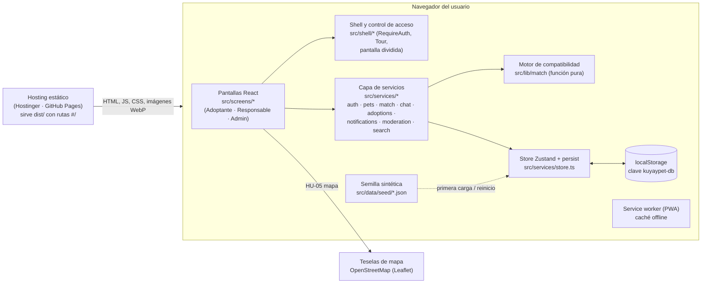
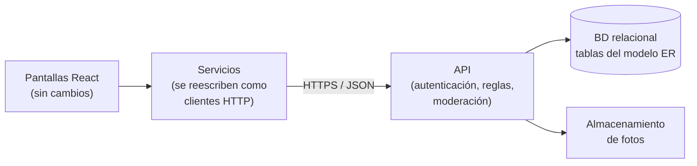

# 🏗️ Arquitectura — KuyayPet

[← Volver a la presentación](../readme.md) · [Modelo de datos](./modelo-datos.md) · [Catálogo de HU](./historias-de-usuario.md)

> Describe la arquitectura **real** del prototipo v0.3 ([`Codigo_Repositorio/kuyaypet-web/`](../Codigo_Repositorio/kuyaypet-web/)), no una arquitectura objetivo. Lo que hoy no existe se marca como tal.

## Vista general

KuyayPet es hoy una **aplicación de una sola página (SPA)** que corre completa en el navegador. No hay servidor de aplicación ni base de datos: el estado vive en un store de Zustand que se guarda en `localStorage` y que, la primera vez, se llena con una **semilla de datos sintéticos** (personas, albergues y mascotas ficticias).

## Componentes

| Componente | Dónde vive | Responsabilidad |
|---|---|---|
| Pantallas | `src/screens/` | Una pantalla por flujo (buscar, perfil de mascota, chats, panel del responsable, panel admin…). Solo llaman a servicios. |
| Shell | `src/shell/` | Layout, `RequireAuth` (sesión y rol por ruta, cierre por inactividad de 15 min), tour guiado y pantalla dividida Adoptante \| Responsable. |
| Servicios | `src/services/` | Reglas de negocio: registro e inicio de sesión, publicación y moderación de mascotas, intereses y Match, chat, solicitudes de adopción, notificaciones, búsqueda y filtros. |
| Motor de compatibilidad | `src/lib/match/` | `computeMatch(adoptante, mascota)`: puntaje 0–100 con razones y advertencias. Sin React ni reloj; se prueba con Vitest. |
| Store ("BD" del prototipo) | `src/services/store.ts` | Estado único persistido en `localStorage`. Solo los servicios lo importan. |
| Semilla | `src/data/seed/` | Datos sintéticos de usuarios, mascotas, chats, solicitudes, reportes y favoritos. |
| Tipos | `src/types/index.ts` | Modelo de dominio compartido (ver [modelo de datos](./modelo-datos.md)). |

## Stack

Vite · React 18 · TypeScript (estricto) · Tailwind CSS · Framer Motion · Zustand (persistido en `localStorage`) · React Router (`HashRouter`, rutas con `#/`) · Leaflet + OpenStreetMap · PWA (`vite-plugin-pwa`) · Vitest (22 pruebas unitarias) · Playwright (21 pruebas de extremo a extremo).

## Límites conocidos (consecuencia directa de no tener backend)

- **Los datos son por navegador.** Lo que publica un responsable en un equipo no lo ve un adoptante en otro equipo. La demo "un responsable publica y otro usuario la encuentra" funciona en el mismo navegador (o con la pantalla dividida), no entre dispositivos.
- **No hay seguridad real.** Las contraseñas de las cuentas demo se guardan en texto plano en `localStorage` y el control de acceso por rol es solo de interfaz.
- **Partes simuladas:** la respuesta de los responsables sintéticos, "Continuar con Google", el envío de correos (bandeja simulada de HU-15) y las notificaciones push.

---

## ADR-K01 · Sin backend en el MVP

**Estado:** vigente para el prototipo v0.3.

**Contexto.** El curso pide demostrar las historias de usuario funcionando desde el Sprint 1, el equipo aún no tenía repositorio común ni capacidad acordada para operar un servidor, y el prototipo debía poder abrirse en el aula sin depender de internet ni de credenciales.

**Decisión.** Implementar el MVP como SPA estática con el estado en `localStorage` y una semilla sintética, detrás de una **capa de servicios** (`src/services/*`) que es la única que toca el almacenamiento.

**Consecuencias.**
- ✅ Se despliega copiando `dist/` a cualquier hosting estático; costo de operación cero.
- ✅ Las 26 HU se pueden recorrer y probar automáticamente (Vitest + Playwright) sin infraestructura.
- ❌ No hay datos compartidos entre usuarios reales, ni autenticación segura, ni persistencia más allá del navegador.
- ❌ La rúbrica menciona "BD inicial": hoy **no existe** una base de datos; existe un modelo de datos tipado y una semilla. Se documenta así para no presentar como hecho lo que no lo es.

**Cómo se migraría (evolución, sin fecha comprometida).**

1. Convertir las entidades de [`modelo-datos.md`](./modelo-datos.md) en tablas de una base de datos relacional (claves foráneas tal como están las relaciones del diagrama).
2. Exponer una API con autenticación real (contraseñas con hash, sesiones o tokens) y las reglas que hoy están en `src/services/*` (por ejemplo, que una publicación quede "En revisión" hasta que el admin la apruebe).
3. Reescribir cada servicio para llamar a la API en lugar del store. Como las pantallas solo usan servicios, la interfaz no debería cambiar.
4. Mover las fotos a un almacenamiento de archivos y dejar la semilla solo para entornos de prueba.

La elección concreta de tecnología de API y de base de datos queda para cuando el equipo la priorice en el Product Backlog.

> ✋ Pendiente: que el equipo revise y apruebe esta ADR (o la reemplace) en una Sprint Review.
