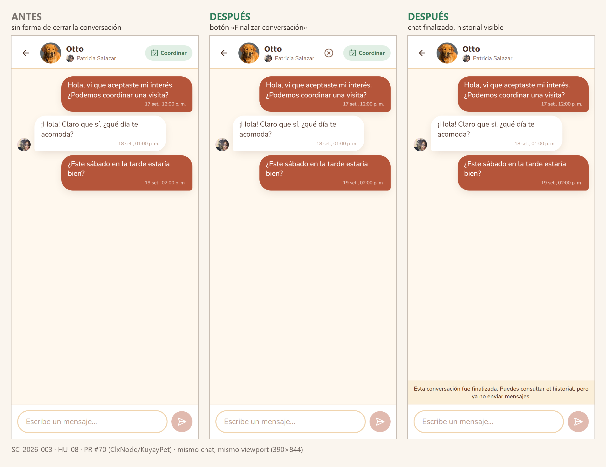

# SC-2026-003 — Finalizar conversación en el chat (HU-08)

**Estado:** Implementada y verificada; pendiente de firmas del Comité.
**Nivel de impacto (preliminar):** Medio, según FOR-GC-002.
**Decisión del Comité:** Pendiente de decisión del Comité.

## Qué se pidió

La historia HU-08 «Comunicarse con el responsable de la mascota» tiene el criterio c9: al finalizar la conversación se conserva el historial. Antes del cambio no existía forma de finalizar una conversación, así que c9 no podía cumplirse desde la app.

El cambio agrega:

- Un botón ⊗ «Finalizar conversación» en el encabezado del chat, junto a «Coordinar». Solo lo ve el adoptante y solo en chats directos (el chat grupal de HU-09 no cambia).
- Un diálogo de confirmación «¿Finalizar la conversación?» con el botón «Finalizar».
- Al finalizar: el historial se conserva, aparece el aviso «Esta conversación fue finalizada. Puedes consultar el historial, pero ya no enviar mensajes.» y se deshabilitan el campo de texto y el botón Enviar.
- En el código: `closeThread` y `closedAt` en el servicio de chat y 6 pruebas Playwright (c2, c3, c5, c6, c8, c9).

## Antes y después

Mismo chat (adoptante demo Valeria con Patricia Salazar, perro Otto) y mismo viewport 390×844. «Antes» es el build del commit `0e3e33f` con el chat de ejemplo corregido, de modo que la única diferencia visible es el PR #70. «Después» es `main` más el PR #102.

Capturas individuales en [`capturas/`](capturas/):

| Archivo | Muestra |
|---|---|
| `antes-1-chat-sin-opcion-de-cerrar.png` | Encabezado solo con «Coordinar». |
| `antes-2-envio-siempre-habilitado.png` | Envío siempre habilitado. |
| `despues-1-chat-con-boton-finalizar.png` | Botón ⊗ «Finalizar conversación». |
| `despues-2-dialogo-confirmacion.png` | Diálogo «¿Finalizar la conversación?». |
| `despues-3-chat-finalizado-envio-deshabilitado.png` | Aviso de cierre y envío deshabilitado. |
| `despues-4-historial-reabierto.png` | Chat reabierto: historial visible. Es el mismo archivo que `despues-3` (misma pantalla). |

## Cómo se verificó

Pruebas ejecutadas el 26/11/2026 sobre `main` más el PR #102 (build local, Chromium, viewport 390×844, `--workers=1`):

| Suite | Resultado |
|---|---|
| Vitest | 45/45 (23 nuevas, de respuestas del chat) |
| Playwright, suite completa | 130/130 pasaron en 5,3 min; 0 fallidas; 0 inestables |
| HU-08 c2, c3, c5, c6, c8, c9 | Todas pasaron |
| Relacionadas: SEG-13, SEG-08, HU-07 c6, HU-09 c2–c6, «Flujo estrella» | Todas pasaron |

El registro de ejecución está en la máquina de verificación (registro local); no se versiona en el repositorio.

Esto prueba que el cambio funciona. No sustituye la decisión del Comité.

## Estado administrativo

- El PR #70 recibió una revisión de código aprobada por VALTOm07 y se integró el 12/11/2026. **Una revisión de código no es una decisión del Comité de Control de Cambios.**
- No hay sesión del Comité, votos, firmas ni conformidad del Solicitante registrados.
- Fuera de esta SC: el defecto del chat de ejemplo (roles cruzados y respuesta simulada genérica) se corrige en el PR #102 sin solicitud de cambio, porque no modifica criterios de aceptación (PRO-GC-001, 1.2). El PR #102 está abierto, sin integrar.

## Enlaces

| Qué | Dónde |
|---|---|
| Issue #8 (HU-08) | https://github.com/ClxNode/KuyayPet/issues/8 |
| PR #70 | https://github.com/ClxNode/KuyayPet/pull/70 |
| PR #102 (defecto relacionado, fuera de la SC) | https://github.com/ClxNode/KuyayPet/pull/102 |
| Producción v1.0.0 | https://firebrick-cod-910257.hostingersite.com/ |
| Video antes/después (`SC-2026-003-antes-despues.mp4`) | https://drive.google.com/open?id=18Ntw9svQuHgiRIzolP-RiwCyiPZbBYA4 |
| Registro de solicitudes | [../registro-solicitudes.md](../registro-solicitudes.md) |
| Expediente en PDF | [expediente-SC-2026-003.pdf](expediente-SC-2026-003.pdf) |

## Formatos

[FOR-GC-001 Solicitud](FOR-GC-001.md) · [FOR-GC-002 Análisis de impacto](FOR-GC-002.md) · [FOR-GC-003 Decisión](FOR-GC-003.md) · [FOR-GC-004 Seguimiento y cierre](FOR-GC-004.md) · [Guion de exposición](guion-exposicion.md)

## Firmas pendientes

| Persona | Rol | Qué firma o decide |
|---|---|---|
| IchiSieben | Solicitante | FOR-GC-001 E (firma del Solicitante); FOR-GC-004 E (conformidad del Solicitante) |
| Joseph Lombardi | Líder del proyecto – Gestor de Cambios | FOR-GC-001 D y E; FOR-GC-003 voto y E; FOR-GC-004 C y E |
| Dylan Quispe | Patrocinador | FOR-GC-003: voto y firma |
| Juan Huapalla | Docente asesor | FOR-GC-003: voto y firma |
| Analista de Impacto (lo designa el Gestor; no puede ser el Solicitante) | Analista | FOR-GC-002 E |

Todas estas celdas dicen «Pendiente de firma» en los formatos.
