# Manual de usuario — KuyayPet

[← Volver a la presentación](../readme.md) · [Documentación técnica](./documentacion-tecnica.md) · [Historias de usuario](./historias-de-usuario.md)

- **Aplicación:** https://firebrick-cod-910257.hostingersite.com/
- **Manual dentro de la aplicación:** https://firebrick-cod-910257.hostingersite.com/manual/
- **Versión desplegada al 19-nov-2026:** `v0.3.1-sprint2`. Incluye lo de los Sprints 1 y 2; **no incluye** los arreglos del Sprint 3. Ver [despliegue](./despliegue.md).

Este manual explica, por rol, cómo realizar las tareas principales. Las capturas son las evidencias de las pruebas automatizadas (`Sprint_0N/7.Pruebas/evidencias/HU-NN/`), tomadas en pantalla de celular (390×844).

> **Capturas de la parte (b) del Sprint 3** (HU-14, 15, 22 a 26): están en `Sprint_03/7.Pruebas/evidencias/` y llegan con el PR [#95](https://github.com/ClxNode/KuyayPet/pull/95), que sigue abierto al 19-nov. Los enlaces a esas imágenes se ven rotos hasta que se fusione.

## 0. Antes de empezar

KuyayPet es un **prototipo sin servidor**: los datos (cuentas, mascotas, chats) se guardan en el navegador que uses. Lo que registres en un equipo no lo ve nadie en otro.

**Cuentas de demostración.** Son datos públicos de prueba, no personas reales.

| Rol | Cómo entrar |
|---|---|
| Adoptante | En la pantalla de inicio, botón **Adoptante** (bajo "Probar la demo como…"), o `adoptante@kuyaypet.pe` |
| Responsable | En la pantalla de inicio, botón **Responsable**, o `responsable@kuyaypet.pe` |
| Administrador | Iniciar sesión con `admin@kuyaypet.pe` y la contraseña `kuyay2026` |

La contraseña de las tres cuentas de demostración es `kuyay2026`. En escritorio aparece además el **modo presentador** (tour guiado, cambio de rol y pantalla dividida con adoptante y responsable lado a lado).

**Qué es simulado.** (1) Las respuestas del responsable en el chat son mensajes de plantilla, no hay una persona al otro lado (HU-08 criterios 4 y 7). (2) El correo de recuperación de contraseña no se envía: se lee en una "bandeja de correo simulada" dentro de la propia aplicación (HU-15). (3) "Continuar con Google" no verifica la identidad. Detalle en [pruebas](./pruebas.md#31-fuera-de-alcance-por-no-haber-backend).

## 1. Visitante (sin cuenta)

### 1.1. Crear una cuenta (HU-01)

1. En la pantalla de inicio, pulsa **Crear cuenta**.
2. Completa nombre, correo y contraseña (mínimo 8 caracteres) y repítela.
3. Pulsa **Registrarse**. Si falta un dato, el correo no tiene formato válido, ya está registrado o la contraseña es corta, aparece un aviso y no se crea la cuenta.
4. Al terminar, se abre el cuestionario de preferencias (ver 2.1).

| Campos obligatorios | Correo duplicado | Cuenta creada |
|---|---|---|
| 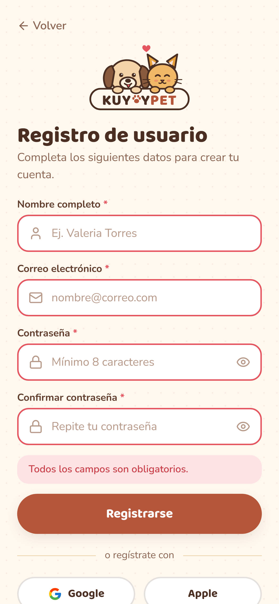 | 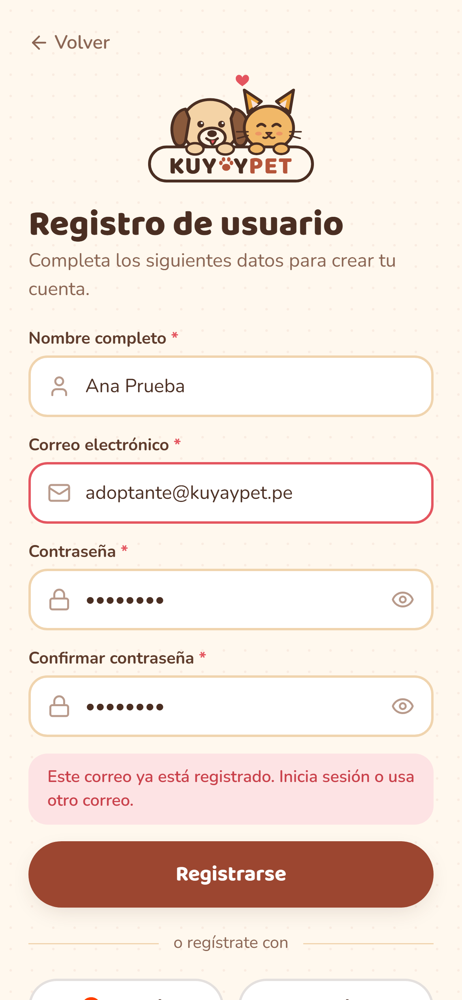 | 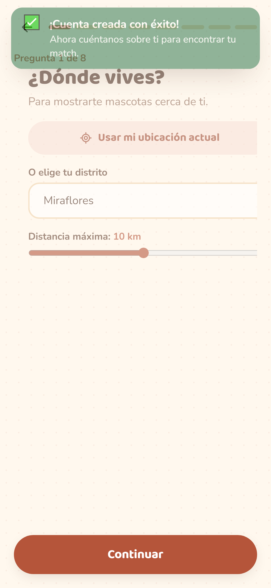 |

### 1.2. Recuperar la contraseña (HU-15)

1. En **Iniciar sesión**, pulsa la opción de recuperar contraseña.
2. Escribe tu correo y pulsa **Enviar enlace de recuperación**.
3. Abre **la bandeja de entrada simulada**, copia el código de 6 dígitos (o pulsa "Usar código") y escribe una contraseña nueva de al menos 8 caracteres, dos veces.
4. Pulsa **Cambiar contraseña** e inicia sesión con la nueva.

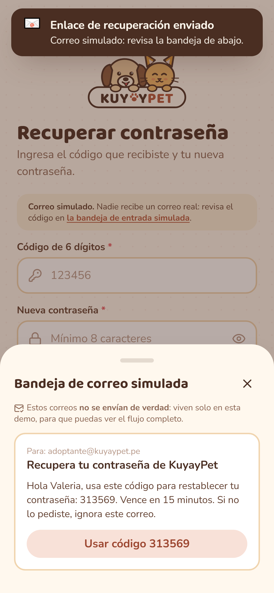

### 1.3. Guía de adopción responsable (HU-14)

La guía es pública y se abre desde **Perfil → Guía de adopción** o desde un perfil de mascota. Tiene categorías desplegables y un buscador ("Buscar en la guía").

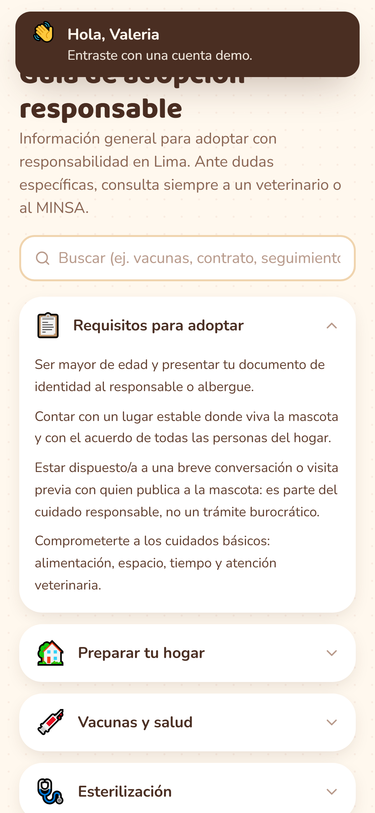

## 2. Adoptante

Barra inferior: **Descubrir**, **Buscar**, **Matches**, **Chats**, **Perfil**.

### 2.1. Indicar tus preferencias

Tras el registro, el cuestionario (varios pasos con **Continuar**) define qué tan compatible es cada mascota contigo. Termina con **Ver mis mascotas compatibles**. Puedes cambiarlas después en **Perfil → Mis preferencias**.

### 2.2. Ver mascotas y su perfil (HU-02, HU-03)

1. En **Descubrir** se ve una pila de tarjetas; en **Buscar**, la lista de mascotas disponibles.
2. Toca una mascota para abrir su perfil: foto, nombre, especie, raza, edad, ubicación e información adicional. Las mascotas adoptadas o en revisión no aparecen como disponibles.

| Lista de disponibles | Perfil detallado |
|---|---|
| 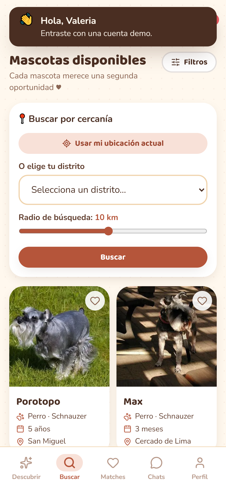 | 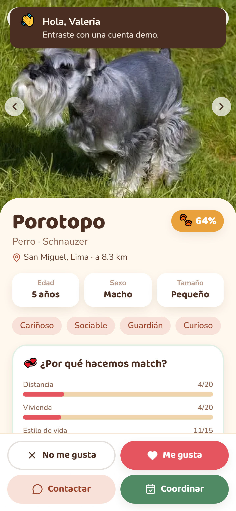 |

### 2.3. Filtrar y buscar por cercanía (HU-04, HU-05)

1. En **Buscar**, abre los filtros, elige especie u otras opciones y pulsa aplicar. Los filtros se combinan.
2. Para cercanía, indica tu ubicación y el radio en km; los resultados muestran la distancia. La vista **Mapa** muestra marcadores dentro del radio.
3. Para volver a ver todo, limpia los filtros.

| Filtros | Resultados | Radio en km |
|---|---|---|
| 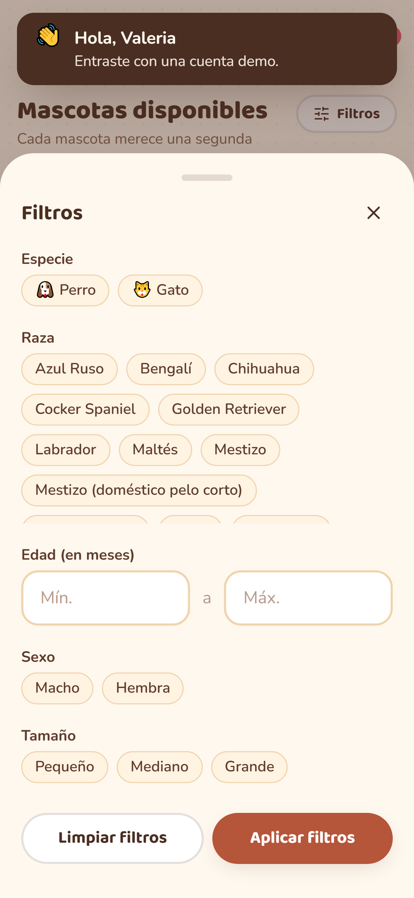 | 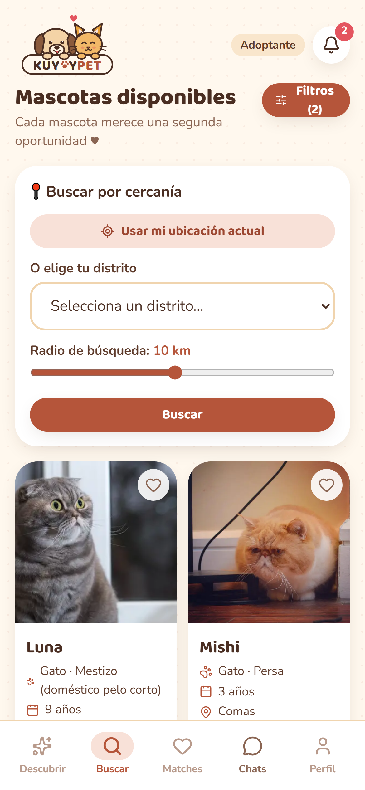 | 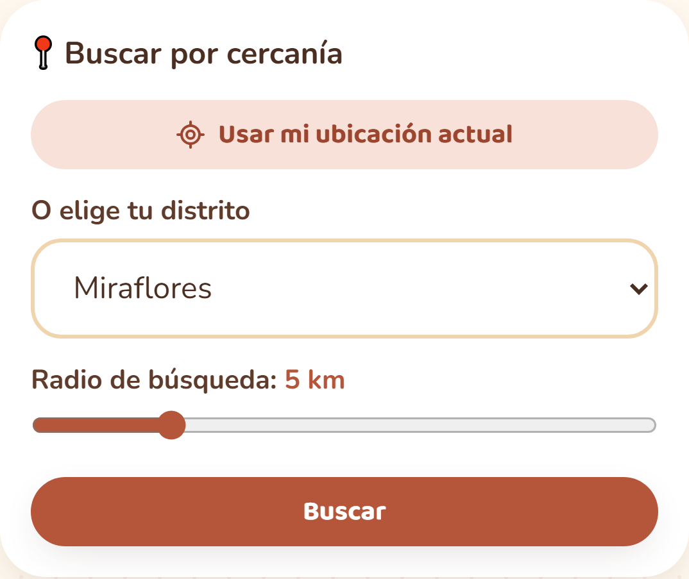 |

### 2.4. Guardar favoritos (HU-17)

Toca el corazón de una mascota para guardarla; vuelve a tocarlo para quitarla. La lista está en **Perfil → Favoritos** y se conserva al volver a iniciar sesión.

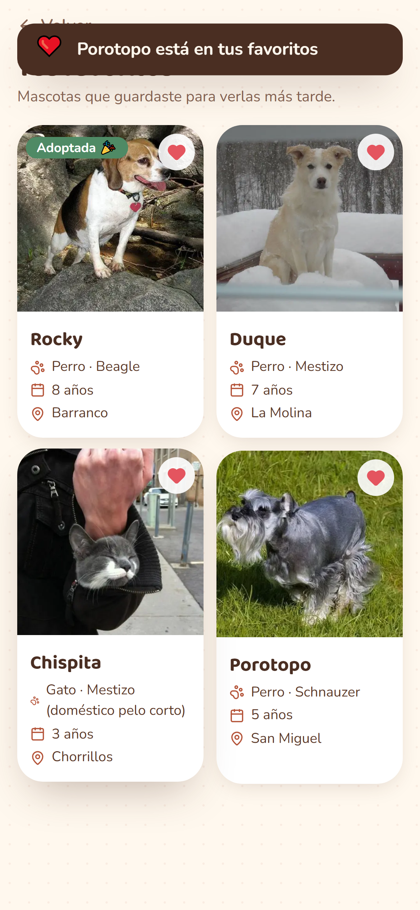

### 2.5. Indicar interés y obtener un Match (HU-06, HU-07, HU-20)

1. En **Descubrir** o en el perfil de una mascota, pulsa **Me gusta** o **No me gusta**. Aparece una confirmación con el nombre de la mascota y puedes seguir con la siguiente.
2. El responsable recibe el aviso y decide. Si acepta, aparece **¡Es un Match!** y recibes una notificación.
3. En **Matches** ves tus mascotas compatibles ordenadas de mayor a menor compatibilidad, con los criterios de compatibilidad. Si no hay, el sistema te invita a editar tus preferencias.

| Me gusta / No me gusta | Match | Mis Matches |
|---|---|---|
| 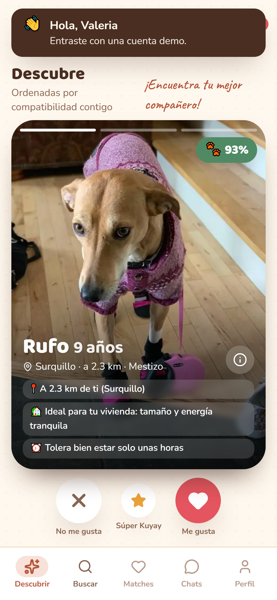 | 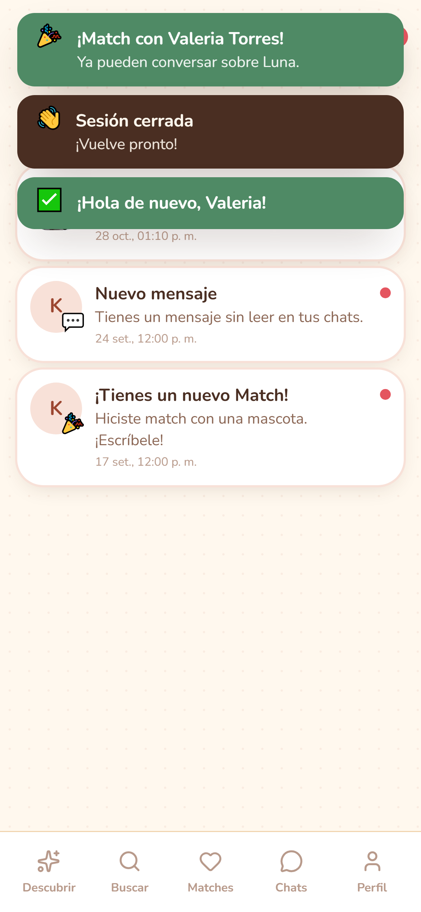 | 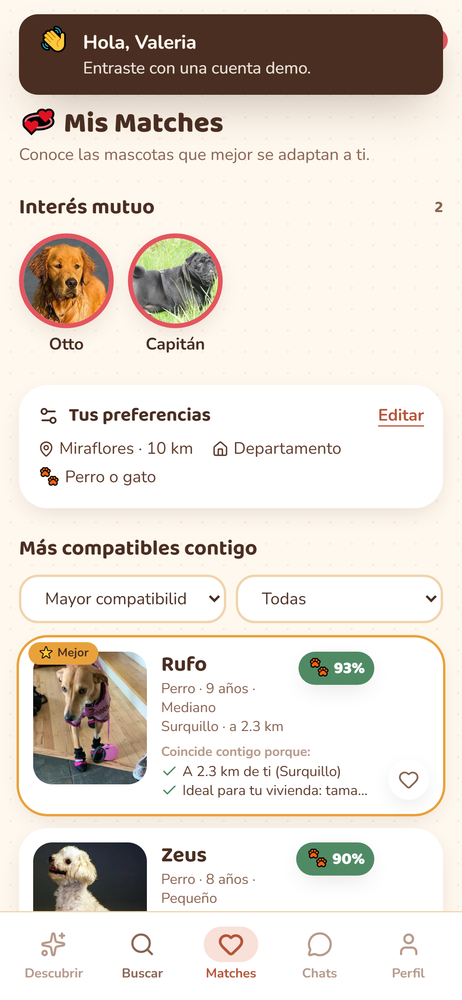 |

### 2.6. Conversar con el responsable (HU-08, HU-09)

1. Tras un Match, pulsa **Continuar al chat**, o abre **Chats**. El chat identifica la mascota.
2. Escribe en el campo **Mensaje** y pulsa **Enviar**; no se puede enviar un mensaje vacío. La respuesta del responsable es simulada.
3. También puedes unirte al **chat grupal de una mascota** para conversar con otros interesados.
4. El responsable o tú pueden finalizar la conversación; el historial se conserva.

| Chat abierto | Mensaje enviado | Chat grupal |
|---|---|---|
| 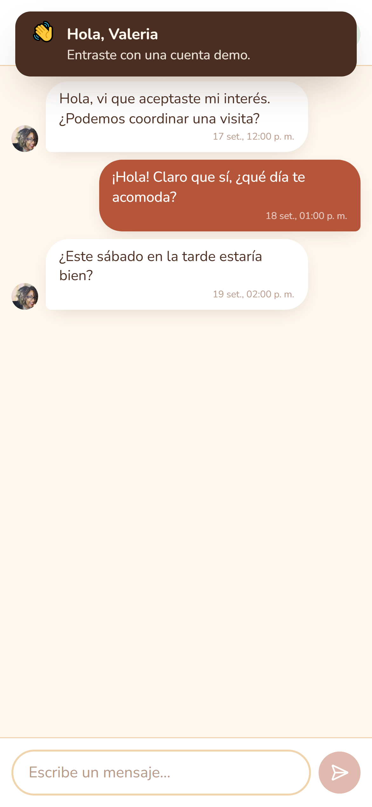 | 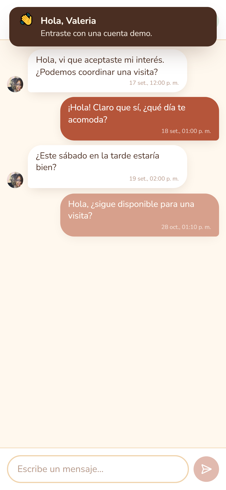 | 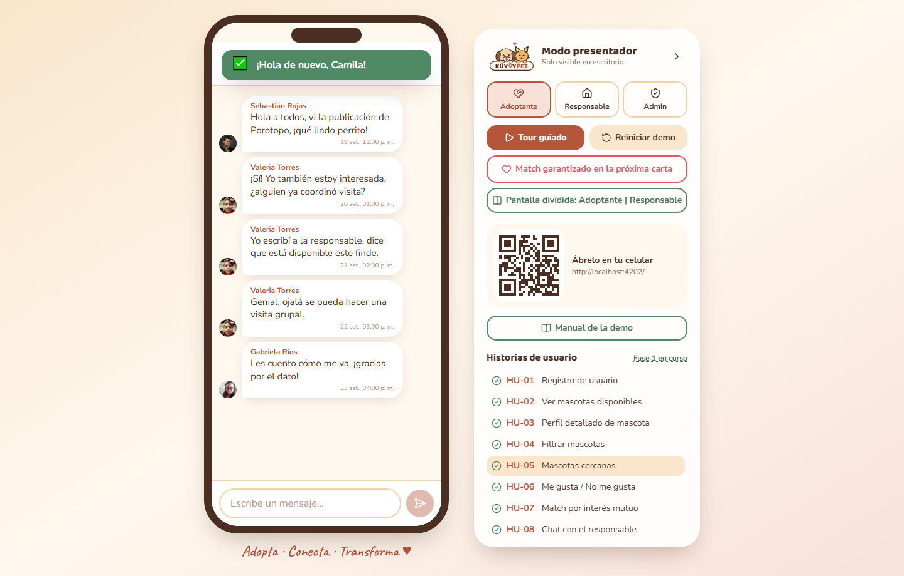 |

### 2.7. Coordinar la adopción (HU-10)

1. Desde el chat, pulsa **Coordinar adopción**.
2. Propón fecha y hora y pulsa **Enviar solicitud**. Aparece **¡Solicitud enviada!** y el estado queda *pendiente*.
3. Cuando el responsable responda, verás la solicitud aceptada o rechazada.

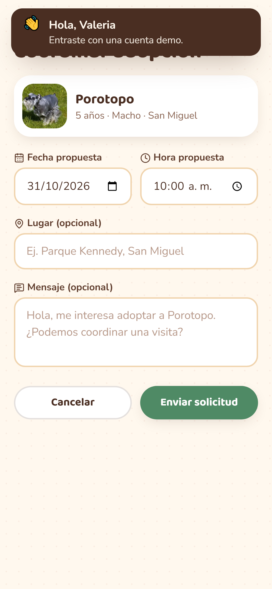

### 2.8. Historial de interés (HU-18)

**Perfil → Historial de interés** lista las mascotas a las que diste "Me gusta", con foto, nombre, fecha y estado actual (disponible, adoptada o retirada).

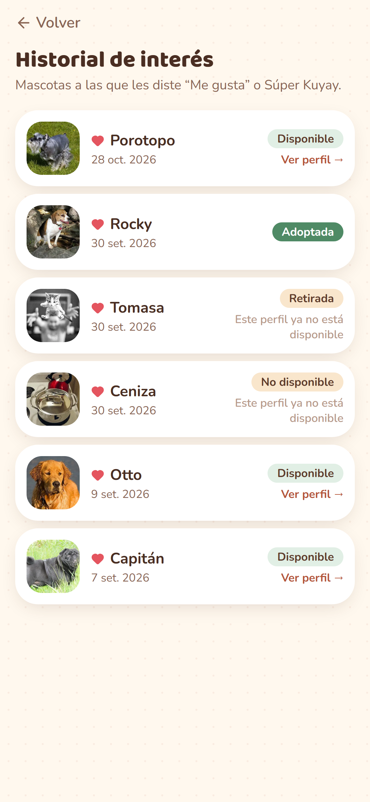

### 2.9. Cerrar sesión (HU-21)

**Perfil → Cerrar sesión** y confirma. Vuelves a la pantalla de inicio de sesión y las páginas privadas dejan de abrirse.

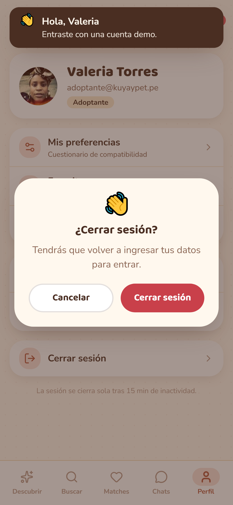

## 3. Responsable de mascotas

Barra inferior: **Mis mascotas**, **Chats**, **Avisos**, **Perfil**.

### 3.1. Registrar una mascota (HU-11, HU-16)

1. En **Mis mascotas**, pulsa el botón de nueva mascota.
2. Completa los tres pasos (datos, características, fotos y etiquetas). Se aceptan solo imágenes; otros formatos se rechazan con "Formato no permitido".
3. Revisa la vista previa y confirma. La mascota queda **En revisión** y no es visible para los adoptantes hasta que el administrador la apruebe.

| Formulario | Mascota registrada | Formato no permitido |
|---|---|---|
| 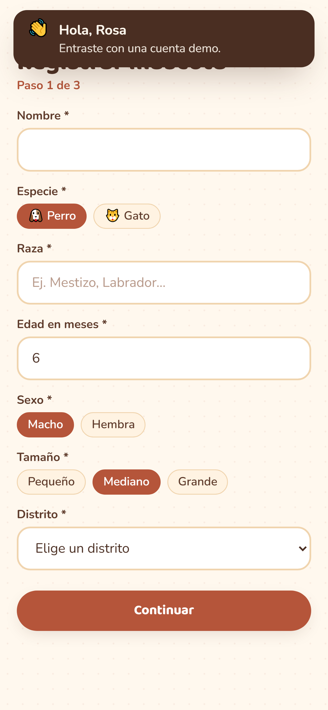 | 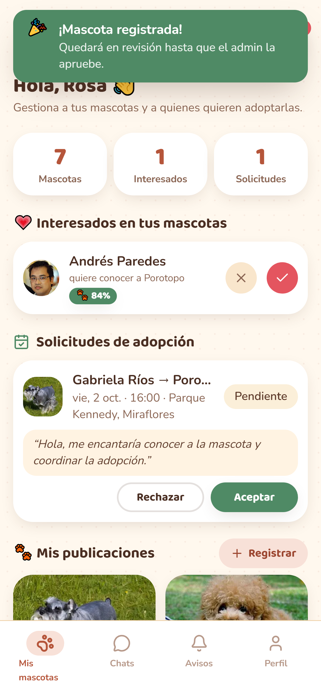 | 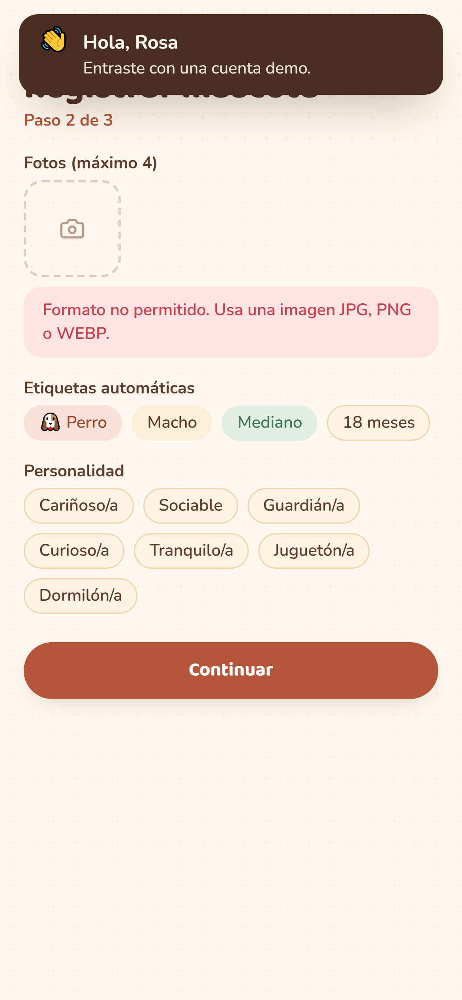 |

> HU-11 criterio 6 figura como **No cumple** en la [matriz de trazabilidad](./matriz-trazabilidad.md): la mascota recién registrada queda *En revisión* y no aparece de inmediato como disponible.

### 3.2. Editar una mascota propia (HU-12)

Abre la mascota desde **Mis mascotas**, modifica los datos y pulsa **Guardar cambios** (o cancela para descartar). Solo puedes editar mascotas que registraste tú.

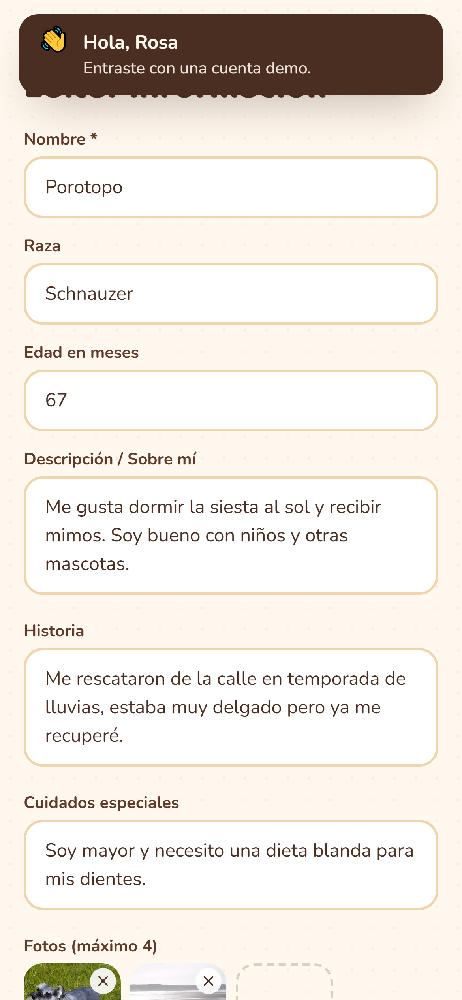

### 3.3. Recibir avisos y responder interés (HU-13, HU-07)

1. **Avisos** (campana) muestra el contador de no leídas y la lista de leídas y no leídas.
2. Al tocar un aviso de interés se abre el perfil del adoptante.
3. En **Mis mascotas** puedes aceptar el interés (se crea el Match) o rechazarlo. También respondes las solicitudes de adopción (HU-10).

| Aviso con contador | Perfil del adoptante |
|---|---|
| 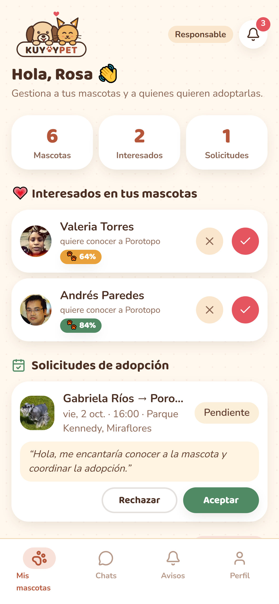 | 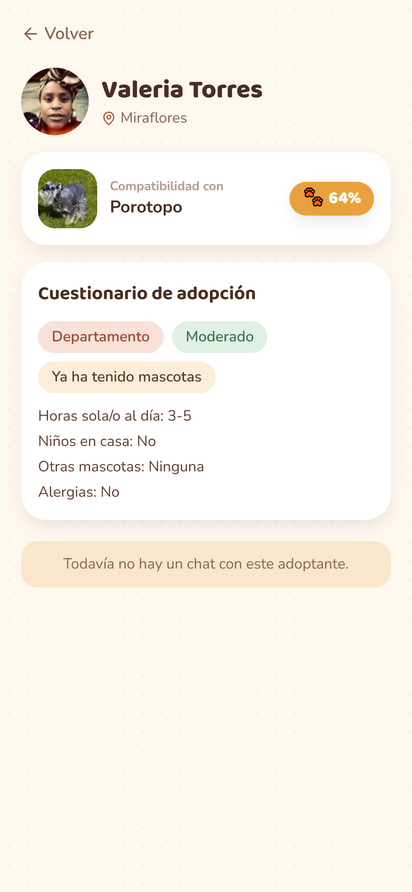 |

### 3.4. Marcar una mascota como adoptada (HU-19)

En **Mis mascotas**, pulsa **Marcar como adoptada** y confirma. La mascota pasa a *Adoptada*, deja de aparecer como disponible y no admite nuevas solicitudes.

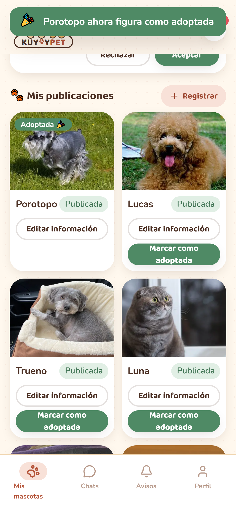

## 4. Administrador

Barra inferior: **Panel**, **Avisos**, **Perfil**. El panel tiene secciones de usuarios, publicaciones y reportes. Estas funciones corresponden a la parte (b) del Sprint 3 (PR abiertos #88–#94 al 19-nov).

### 4.1. Gestionar usuarios (HU-22) y desactivar cuentas (HU-25)

1. **Usuarios** lista las cuentas; busca por nombre o correo.
2. Abre una cuenta para ver su información y estado, y edítala con **Guardar cambios**.
3. **Desactivar usuario** pide confirmación. La cuenta desactivada no puede iniciar sesión; **Reactivar usuario** la habilita de nuevo. Si ya está inactiva, el sistema lo informa.

| Lista de usuarios | Confirmar desactivación | Login bloqueado |
|---|---|---|
| 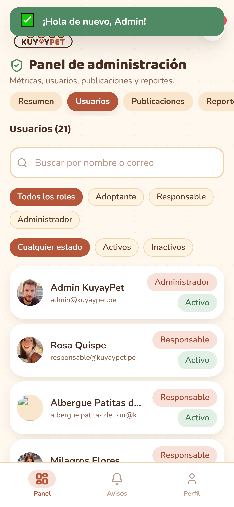 | 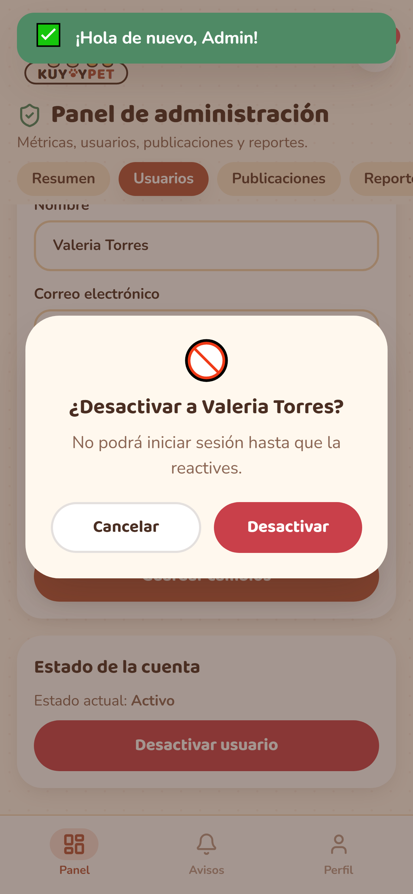 | 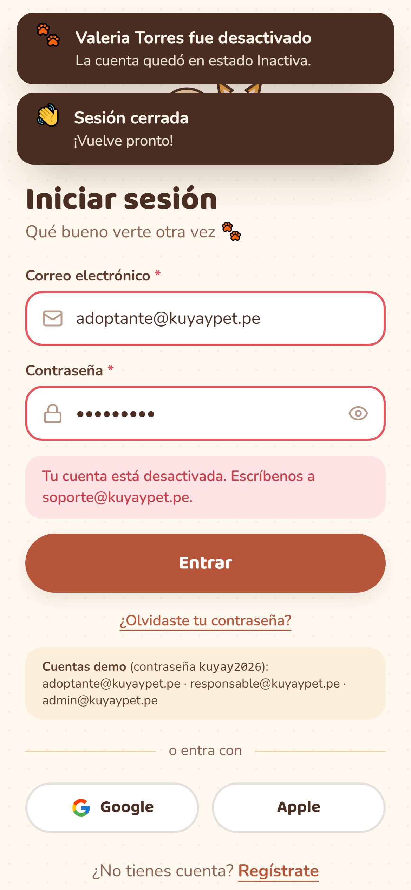 |

### 4.2. Revisar publicaciones (HU-23) y aprobar o rechazar (HU-24)

1. **Publicaciones** lista las mascotas; filtra por estado.
2. Abre una para ver sus datos y características; puedes editarla y guardar.
3. **Aprobar** (con confirmación): pasa a *Aprobada* y es visible para los adoptantes.
4. **Rechazar**: exige escribir el **motivo del rechazo**; pasa a *Rechazada* y el responsable ve el estado.

| Lista | Confirmar aprobación | Motivo de rechazo |
|---|---|---|
| 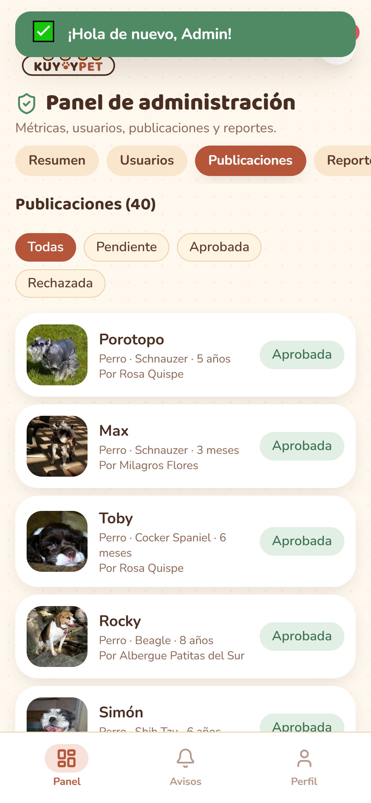 | 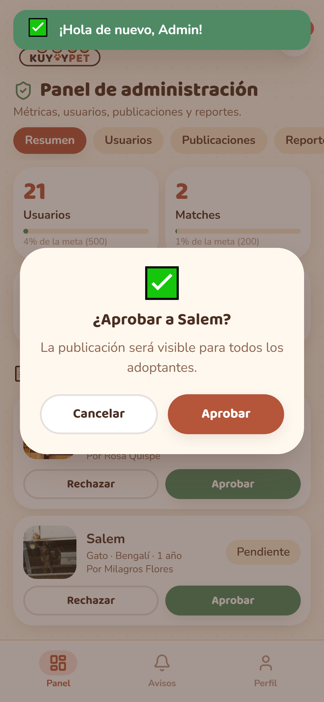 | 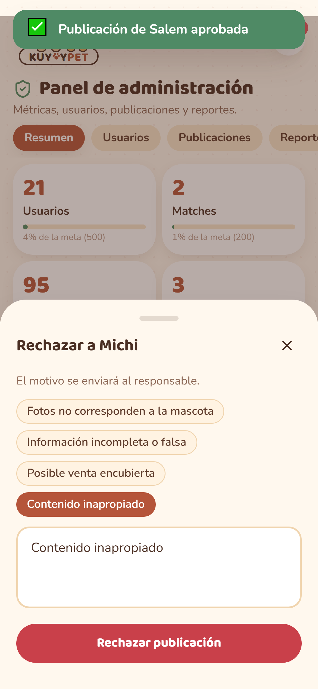 |

### 4.3. Atender reportes (HU-26)

1. **Reportes** lista las denuncias; abre una.
2. Para retirar contenido inapropiado: **Ocultar** la publicación reportada (sale de Descubrir y queda rechazada) o **Desactivar** la cuenta responsable.
3. Si no procede, **Descartar reporte** con una nota de resolución.
4. Un usuario sin rol de administrador no puede abrir estas pantallas.

| Publicación ocultada | Adoptante sin acceso |
|---|---|
| 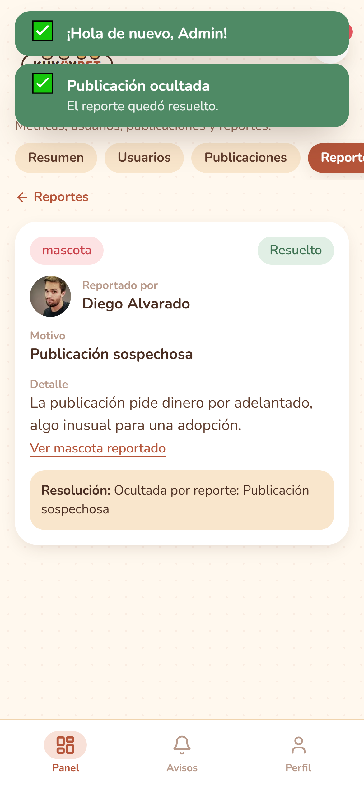 | 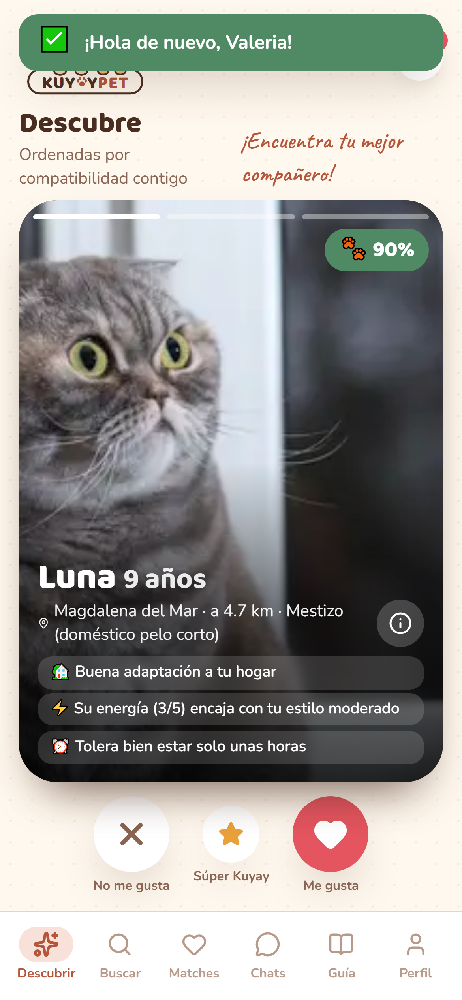 |

## 5. Si algo no funciona

- **No veo mis datos:** los datos están en este navegador. Si borras los datos del sitio o cambias de navegador, empiezas con los datos de demostración.
- **Reiniciar la demo:** en escritorio, el panel de presentador tiene la opción de reiniciar.
- **Una cuenta no entra:** puede estar desactivada por el administrador (aviso "cuenta desactivada").
- **La aplicación no se actualiza:** al ser una aplicación instalable (PWA), recarga la página una vez más para tomar la versión nueva.
