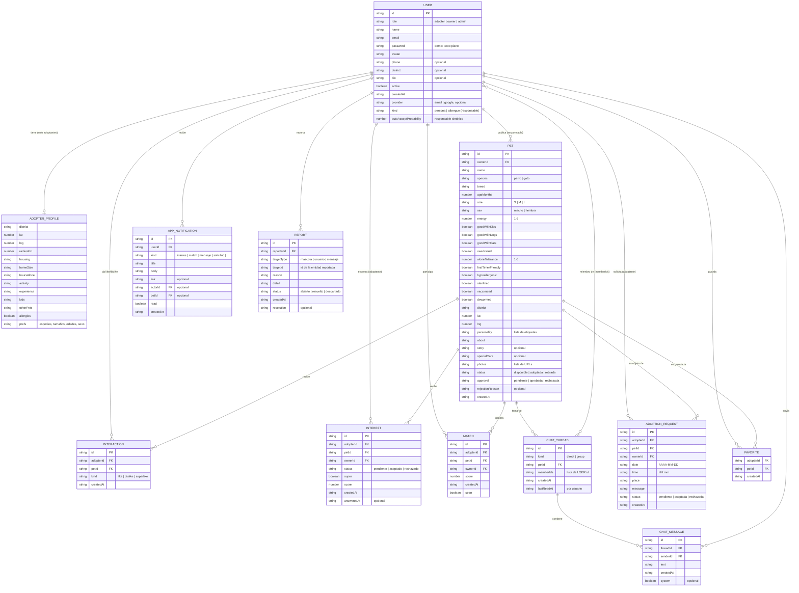

# 🗃️ Modelo derivado del prototipo

[← Volver a la presentación](../readme.md) · [Arquitectura](./arquitectura.md) · [Catálogo de HU](./historias-de-usuario.md)

> Este modelo **se derivó de los tipos del código** ([`Codigo_Repositorio/kuyaypet-web/src/types/index.ts`](../Codigo_Repositorio/kuyaypet-web/src/types/index.ts)), no al revés. Hoy no existe una base de datos: estas entidades viven como listas dentro de un store guardado en `localStorage` (ver [ADR-K01](./arquitectura.md#adr-k01--sin-backend-en-el-mvp)). Si el equipo migra a una BD relacional, cada entidad sería una tabla y cada `…Id` una clave foránea.

## Diagrama entidad-relación

## Entidades

| Entidad (tipo en el código) | Qué representa | HU que la usan |
|---|---|---|
| `USER` (`User`) | Cuenta con rol adoptante, responsable o administrador | HU-01, HU-15, HU-21, HU-22, HU-25 |
| `ADOPTER_PROFILE` (`AdopterProfile`) | Respuestas del cuestionario del adoptante; va **incrustado** en `User.profile` | HU-05, HU-07, HU-20 |
| `PET` (`Pet`) | Mascota publicada por un responsable, con estado de adopción y de moderación | HU-02, HU-03, HU-04, HU-11, HU-12, HU-16, HU-19, HU-23, HU-24 |
| `INTERACTION` (`Interaction`) | Like / dislike / superlike de un adoptante sobre una mascota | HU-06, HU-18 |
| `INTEREST` (`Interest`) | Interés pendiente de respuesta del responsable; aceptado equivale a Match | HU-06, HU-07, HU-13 |
| `MATCH` (`Match`) | Interés mutuo adoptante–mascota con su puntaje | HU-07, HU-20 |
| `CHAT_THREAD` (`ChatThread`) | Conversación directa o grupal sobre una mascota | HU-08, HU-09 |
| `CHAT_MESSAGE` (`ChatMessage`) | Mensaje dentro de una conversación | HU-08, HU-09 |
| `ADOPTION_REQUEST` (`AdoptionRequest`) | Propuesta de fecha, hora y lugar para conocer a la mascota | HU-10 |
| `APP_NOTIFICATION` (`AppNotification`) | Aviso dentro de la app para un usuario | HU-13 |
| `REPORT` (`Report`) | Reporte de contenido inapropiado sobre una mascota, usuario o mensaje | HU-26 |
| `FAVORITE` (`Favorite`) | Mascota guardada por un adoptante | HU-17 |

## Relaciones

| Relación | Cardinalidad | Campo que la implementa |
|---|---|---|
| Usuario responsable publica mascotas | 1 a N | `Pet.ownerId` |
| Usuario adoptante tiene un perfil de preferencias | 1 a 0..1 | `User.profile` (incrustado) |
| Adoptante interactúa con mascotas | N a N, vía `INTERACTION` | `Interaction.adopterId`, `Interaction.petId` |
| Adoptante expresa interés en mascota de un responsable | N a N, vía `INTEREST` | `adopterId`, `petId`, `ownerId` |
| Match entre adoptante, mascota y responsable | N a N, vía `MATCH` | `adopterId`, `petId`, `ownerId` |
| Conversación sobre una mascota | 1 mascota a N conversaciones | `ChatThread.petId` |
| Miembros de una conversación | N a N | `ChatThread.memberIds` (lista) |
| Mensajes de una conversación | 1 a N | `ChatMessage.threadId`, `ChatMessage.senderId` |
| Solicitud de adopción | N a N, vía `ADOPTION_REQUEST` | `adopterId`, `petId`, `ownerId` |
| Notificaciones de un usuario | 1 a N | `AppNotification.userId` (y opcionales `actorId`, `petId`) |
| Reportes | 1 usuario a N reportes; objetivo polimórfico | `Report.reporterId` + `targetType`/`targetId` |
| Favoritos | N a N, vía `FAVORITE` | `Favorite.adopterId`, `Favorite.petId` |

## Notas para una futura BD relacional

- `ownerId` se repite en `INTEREST`, `MATCH` y `ADOPTION_REQUEST` aunque se puede deducir de `PET.ownerId`: en el prototipo evita búsquedas; en una BD habría que decidir si se normaliza.
- `memberIds`, `photos`, `personality` y `prefs` son listas: en una BD relacional serían tablas aparte (por ejemplo, `chat_member`, `pet_photo`).
- `REPORT.targetId` apunta a tablas distintas según `targetType`; en una BD se resolvería con una columna por tipo o con una tabla por tipo de reporte.
- `USER.password` está en texto plano solo porque es una demo local; una BD real guardaría un hash.
- `MatchResult` y `Reason` del código son resultados calculados por el motor, no datos persistidos: por eso no aparecen como entidades.

> ✋ Pendiente: que el equipo valide este modelo como "modelo ER" del Sprint 1 o pida cambios.
