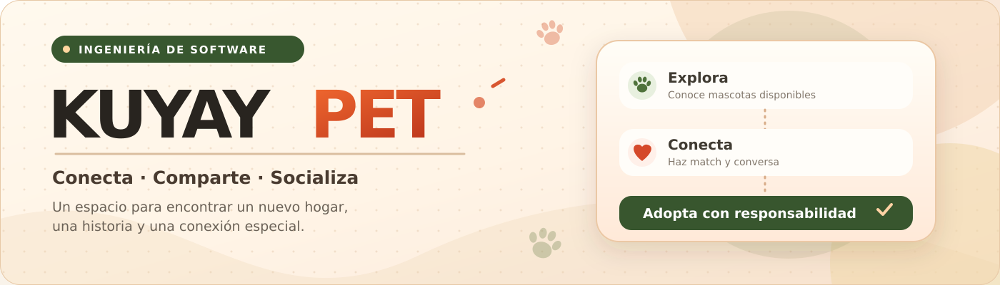
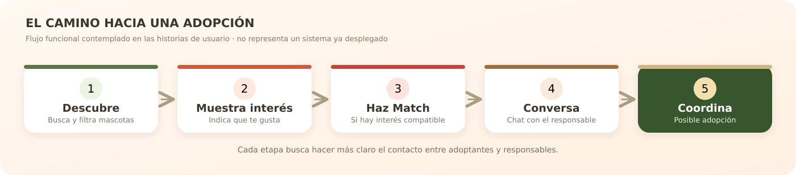

<div align="center">



<br />

### 🐾 Conecta · Comparte · Socializa

**Una plataforma web pensada para conectar mascotas que buscan hogar con personas dispuestas a adoptar.**

<p>
  
  
  
  
</p>

[**El proyecto**](#-sobre-kuyaypet) · [**Funcionalidades**](#-funcionalidades-propuestas) · [**Historias de usuario**](#-historias-de-usuario) · [**Organización**](#-estructura-del-repositorio)

</div>

---

## 🧡 Sobre KuyayPet

**KuyayPet** es un proyecto académico de **Ingeniería de Software** que propone una plataforma web de conexión y socialización alrededor de la **adopción de mascotas**.

La idea es facilitar que una persona pueda conocer mascotas disponibles, explorar sus perfiles, expresar interés y contactar a sus responsables. Al mismo tiempo, quienes publican una mascota pueden compartir su información, gestionar solicitudes y acompañar el proceso de una posible adopción.

El proyecto incluye una dinámica de **Like / Dislike y Match** para apoyar la interacción, junto con herramientas de búsqueda, comunicación y administración de la plataforma.

> **Estado del proyecto:** el alcance funcional está documentado mediante historias de usuario y prototipos. Este README presenta la **visión del producto**; las funcionalidades descritas no deben interpretarse como implementadas hasta que se publique su código.

## ✨ Funcionalidades propuestas

<table>
  <tr>
    <td width="50%" valign="top">
      <h3>🔎 Descubrimiento de mascotas</h3>
      Consulta de mascotas disponibles, perfiles, filtros de preferencias y búsqueda por cercanía.
    </td>
    <td width="50%" valign="top">
      <h3>❤️ Interés y compatibilidad</h3>
      Like / Dislike, favoritos, historial de interés y coincidencias mediante Match.
    </td>
  </tr>
  <tr>
    <td valign="top">
      <h3>💬 Comunicación y adopción</h3>
      Chat con responsables, notificaciones y coordinación de una posible adopción.
    </td>
    <td valign="top">
      <h3>🐕 Publicación de mascotas</h3>
      Registro, fotografías, edición de datos y actualización del estado de adopción.
    </td>
  </tr>
  <tr>
    <td valign="top">
      <h3>🔐 Cuentas y acceso</h3>
      Registro de usuarios, recuperación de contraseña y cierre de sesión.
    </td>
    <td valign="top">
      <h3>🛡️ Administración</h3>
      Gestión de usuarios, revisión, aprobación y moderación de publicaciones.
    </td>
  </tr>
</table>

## 🐾 ¿Cómo funcionaría?

<div align="center">
  
</div>

El recorrido resume la experiencia prevista: **explorar**, **indicar interés**, obtener un **Match cuando exista compatibilidad**, **conversar con el responsable** y, finalmente, **coordinar una posible adopción**. La confirmación definitiva depende de las personas involucradas.

## 👥 ¿A quién está dirigido?

| Rol | Participación dentro de KuyayPet |
|:--|:--|
| **Usuario común** | Se registra, consulta información e interactúa con la plataforma. |
| **Adoptante** | Busca mascotas, revisa perfiles, expresa interés y coordina adopciones. |
| **Responsable de mascota** | Publica mascotas, actualiza sus datos y responde al interés recibido. |
| **Administrador** | Gestiona usuarios y supervisa el contenido y las publicaciones. |

## 📋 Historias de usuario

KuyayPet cuenta con **26 historias de usuario (HU-01 a HU-26)** definidas para describir el alcance funcional del sistema. Las historias incluyen roles, necesidades y prioridades; su desarrollo contempla criterios de aceptación y, cuando corresponde, prototipos de interfaz. [1]

| Módulo | Historias relacionadas |
|:--|:--|
| Acceso y cuentas | `HU-01` · `HU-15` · `HU-21` |
| Descubrimiento e información | `HU-02` · `HU-03` · `HU-04` · `HU-05` · `HU-14` |
| Interacción y compatibilidad | `HU-06` · `HU-07` · `HU-17` · `HU-18` · `HU-20` |
| Comunicación y adopción | `HU-08` · `HU-09` · `HU-10` · `HU-13` |
| Publicación y gestión de mascotas | `HU-11` · `HU-12` · `HU-16` · `HU-19` |
| Administración y moderación | `HU-22` · `HU-23` · `HU-24` · `HU-25` · `HU-26` |

<div align="center">

### [📖 Ver el catálogo completo de las 26 historias de usuario](./docs/historias-de-usuario.md)

</div>

## 🧩 Modelado del sistema

Como parte del trabajo de Ingeniería de Software, el proyecto considera los siguientes diagramas UML para representar los procesos e interacciones del sistema:

- **Diagrama de casos de uso**
- **Diagrama de actividades**
- **Diagrama de secuencia**
- **Diagrama de componentes**
- **Diagrama de colaboración o comunicación**

Los modelos y sus archivos se incorporarán al repositorio conforme se revisen y organicen para su entrega.

## 📂 Estructura del repositorio

```text
KuyayPet/
│
├── README.md                         # Presentación principal
├── assets/
│   ├── branding/
│   │   ├── banner-kuyaypet.svg      # Banner vectorial del proyecto
│   │   └── logo-kuyaypet.png        # Logo oficial
│   └── diagrams/
│       └── recorrido-adopcion.svg   # Flujo de la experiencia
│
├── docs/
│   ├── historias-de-usuario.md      # Catálogo de HU-01 a HU-26
│   └── GUIA_DE_SUBIDA.md            # Instrucciones para GitHub
│
└── historias-de-usuario/
    ├── README.md                     # Índice de futuras entregas de código
    └── PLANTILLA_HU.md              # Plantilla para documentar cada HU
```

**Próxima etapa:** agregar cada implementación en su propia carpeta, por ejemplo `historias-de-usuario/HU-01/`, junto con su explicación y sus pruebas. **La tecnología de implementación todavía no se especifica aquí** para no atribuir al proyecto herramientas que no se hayan definido.

## 🚀 Avance del proyecto

- [x] Definición de la idea y alcance de KuyayPet.
- [x] Identificación de los principales tipos de usuario.
- [x] Elaboración de las 26 historias de usuario.
- [x] Redacción de criterios de aceptación y elaboración de prototipos de referencia.
- [ ] Organización y publicación de los modelos UML definitivos.
- [ ] Implementación del código asociado a las HU.
- [ ] Pruebas funcionales y validación de los criterios de aceptación.
- [ ] Integración y presentación de la aplicación.

## 🎓 Contexto académico

| | |
|:--|:--|
| **Proyecto** | KuyayPet |
| **Curso** | Ingeniería de Software |
| **Universidad** | Universidad Peruana Cayetano Heredia (UPCH) |
| **Tipo de solución** | Plataforma web de adopción y socialización de mascotas |
| **Enfoque de trabajo** | Historias de usuario, criterios de aceptación, prototipado y modelado UML |

## 📚 Referencias

[1] *Lista de historias de usuario – KuyayPet*, documento interno del proyecto de Ingeniería de Software, Universidad Peruana Cayetano Heredia, 2026.

---

<div align="center">

**KuyayPet · Conecta, comparte y socializa**

*Porque cada mascota merece la oportunidad de encontrar un hogar.* 🐾

</div>
