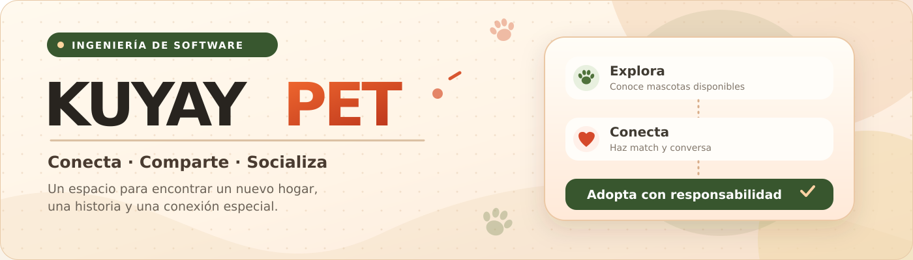
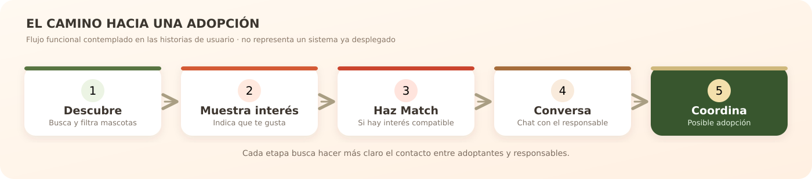

 

### 🐾 Conecta · Comparte · Socializa

**Una plataforma web pensada para conectar mascotas que buscan hogar con personas dispuestas a adoptar.**

  
  
  
  

[**El proyecto**](#-sobre-kuyaypet) · [**Funcionalidades**](#-funcionalidades-propuestas) · [**Historias de usuario**](#-historias-de-usuario) · [**Sprints**](#-sprints-y-estado-del-proyecto) · [**Organización**](#-cómo-navegar-el-repositorio)

---

## 🧡 Sobre KuyayPet

**KuyayPet.** es un proyecto académico de **Ingeniería de Software** que propone una plataforma web de conexión y socialización alrededor de la **adopción de mascotas**.

La idea es facilitar que una persona pueda conocer mascotas disponibles, explorar sus perfiles, expresar interés y contactar a sus responsables. Al mismo tiempo, quienes publican una mascota pueden compartir su información, gestionar solicitudes y acompañar el proceso de una posible adopción.

El proyecto incluye una dinámica de **Like / Dislike y Match** para apoyar la interacción, junto con herramientas de búsqueda, comunicación y administración de la plataforma.

> **Estado del proyecto (19-nov-2026):** el alcance funcional está documentado mediante historias de usuario y existe un **prototipo funcional** sin servidor (los datos viven en el navegador; el chat y el correo de recuperación son simulados). Las 26 historias están implementadas en el prototipo; las 26 están terminadas y fusionadas (los PR de la parte b del Sprint 3 se fusionaron el 19-nov). Ver [Sprints y estado del proyecto](#-sprints-y-estado-del-proyecto) y [cierre del proyecto](./docs/cierre-proyecto.md).

**Aplicación:** https://firebrick-cod-910257.hostingersite.com/ · versión desplegada `v1.0.0` desde el 19-nov-2026 (ver [despliegue](./docs/despliegue.md)) · [manual de usuario](./docs/manual-usuario.md) · manual dentro de la app: https://firebrick-cod-910257.hostingersite.com/manual/

## ✨ Funcionalidades propuestas

<table>
  <tr>
    <td width="50%" valign="top">
      <h3>🔎 Descubrimiento de mascotas</h3>
      Consulta de mascotas disponibles, perfiles, filtros de preferencias y búsqueda por cercanía.
    </td>
    <td width="50%" valign="top">
      <h3>❤️ Interés y compatibilidad</h3>
      Like / Dislike, favoritos, historial de interés y coincidencias mediante Match.
    </td>
  </tr>
  <tr>
    <td valign="top">
      <h3>💬 Comunicación y adopción</h3>
      Chat con responsables, notificaciones y coordinación de una posible adopción.
    </td>
    <td valign="top">
      <h3>🐕 Publicación de mascotas</h3>
      Registro, fotografías, edición de datos y actualización del estado de adopción.
    </td>
  </tr>
  <tr>
    <td valign="top">
      <h3>🔐 Cuentas y acceso</h3>
      Registro de usuarios, recuperación de contraseña y cierre de sesión.
    </td>
    <td valign="top">
      <h3>🛡️ Administración</h3>
      Gestión de usuarios, revisión, aprobación y moderación de publicaciones.
    </td>
  </tr>
</table>

## 🐾 ¿Cómo funcionaría?

  

El recorrido resume la experiencia prevista: **explorar**, **indicar interés**, obtener un **Match cuando exista compatibilidad**, **conversar con el responsable** y, finalmente, **coordinar una posible adopción**. La confirmación definitiva depende de las personas involucradas.

## 👥 ¿A quién está dirigido?

| Rol | Participación dentro de KuyayPet |
|:--|:--|
| **Usuario común** | Se registra, consulta información e interactúa con la plataforma. |
| **Adoptante** | Busca mascotas, revisa perfiles, expresa interés y coordina adopciones. |
| **Responsable de mascota** | Publica mascotas, actualiza sus datos y responde al interés recibido. |
| **Administrador** | Gestiona usuarios y supervisa el contenido y las publicaciones. |

## 📋 Historias de usuario

KuyayPet cuenta con **26 historias de usuario (HU-01 a HU-26)** definidas para describir el alcance funcional del sistema. Las historias incluyen roles, necesidades y prioridades; su desarrollo contempla criterios de aceptación y, cuando corresponde, prototipos de interfaz. [1]

| Módulo | Historias relacionadas |
|:--|:--|
| Acceso y cuentas | `HU-01` · `HU-15` · `HU-21` |
| Descubrimiento e información | `HU-02` · `HU-03` · `HU-04` · `HU-05` · `HU-14` |
| Interacción y compatibilidad | `HU-06` · `HU-07` · `HU-17` · `HU-18` · `HU-20` |
| Comunicación y adopción | `HU-08` · `HU-09` · `HU-10` · `HU-13` |
| Publicación y gestión de mascotas | `HU-11` · `HU-12` · `HU-16` · `HU-19` |
| Administración y moderación | `HU-22` · `HU-23` · `HU-24` · `HU-25` · `HU-26` |

### [📖 Ver el catálogo completo de las 26 historias de usuario](./docs/historias-de-usuario.md)

## 🧩 Modelado del sistema

Como parte del trabajo de Ingeniería de Software, el proyecto considera los siguientes diagramas UML para representar los procesos e interacciones del sistema:

- **Diagrama de casos de uso**
- **Diagrama de actividades**
- **Diagrama de secuencia**
- **Diagrama de componentes**
- **Diagrama de colaboración o comunicación**

La arquitectura y el modelo de datos están en [docs/arquitectura.md](./docs/arquitectura.md) y [docs/modelo-datos.md](./docs/modelo-datos.md). Los demás diagramas UML de la lista se incorporarán al repositorio conforme se revisen y organicen para su entrega.

## 🏃 Sprints y estado del proyecto

El curso se desarrolló en **3 sprints** con Scrum. Cada carpeta `Sprint_0N` tiene sus 8 secciones (backlog, planning, daily, retrospectiva, tablero, código, pruebas y review).

| Sprint | Objetivo | HU | Estado al 19-nov-2026 | Documentos |
|:--|:--|:--|:--|:--|
| Sprint 1 | Registrarse, ver mascotas y su perfil | HU-01, 02, 03 | Terminado y fusionado | [Sprint_01](./Sprint_01/readme.md) |
| Sprint 2 | Catálogo: registro y edición de mascotas, filtros, cercanía y favoritos | HU-04, 05, 11, 12, 16, 17, 19, 21 | Terminado y fusionado | [Sprint_02](./Sprint_02/readme.md) |
| Sprint 3 | Adopción y cierre del producto | (a) HU-06, 07, 08, 09, 10, 13, 18, 20 · (b) HU-14, 15, 22–26 | (a) terminada y fusionada el 12-nov; (b) PR #88–#95 y #99 fusionados el 19-nov; el milestone vence el 27-nov | [Sprint_03](./Sprint_03/readme.md) |

Documentos de ingeniería (carpeta [`docs/`](./docs/)): [historias de usuario](./docs/historias-de-usuario.md) · [análisis](./docs/analisis.md) · [arquitectura](./docs/arquitectura.md) · [modelo de datos](./docs/modelo-datos.md) · [matriz de trazabilidad](./docs/matriz-trazabilidad.md) · [pruebas](./docs/pruebas.md) · [manual de usuario](./docs/manual-usuario.md) · [documentación técnica](./docs/documentacion-tecnica.md) · [despliegue](./docs/despliegue.md) · [cierre del proyecto](./docs/cierre-proyecto.md).

## 👥 Equipo

DevBrad, Dylan Quispe, IchiSieben, Joseph-L-Q, kevinesty, Gael Milla y Juan Vidal (según [Sprint_01](./Sprint_01/readme.md)).

## 🧭 Cómo navegar el repositorio

| Carpeta | Contenido |
|:--|:--|
| [`Sprint_01`](./Sprint_01/readme.md), [`Sprint_02`](./Sprint_02/readme.md), [`Sprint_03`](./Sprint_03/readme.md) | Documentos de Scrum de cada sprint; las evidencias de pruebas están en `Sprint_0N/7.Pruebas/evidencias/HU-NN/` |
| [`docs/`](./docs/) | Documentación de ingeniería de software |
| [`Codigo_Repositorio/`](./Codigo_Repositorio/readme.md) | Código de la aplicación (`kuyaypet-web`): ver [documentación técnica](./docs/documentacion-tecnica.md) |
| [`historias-de-usuario/`](./historias-de-usuario/) | Fuentes de las 26 historias de usuario |
| [`CONTRIBUTING.md`](./CONTRIBUTING.md) | Cómo trabaja el equipo con GitHub (ramas, commits, PR) |

Las ramas `sprint-4/*` conservan ese nombre por historia; el curso tiene 3 sprints.

## 🎓 Contexto académico

| | |
|:--|:--|
| **Proyecto** | KuyayPet |
| **Curso** | Ingeniería de Software |
| **Universidad** | Universidad Peruana Cayetano Heredia (UPCH) |
| **Tipo de solución** | Plataforma web de adopción y socialización de mascotas |
| **Enfoque de trabajo** | Historias de usuario, criterios de aceptación, prototipado y modelado UML |

## 📚 Referencias:

[1] *Lista de historias de usuario – KuyayPet*, documento interno del proyecto de Ingeniería de Software, Universidad Peruana Cayetano Heredia, 2026.

---

**KuyayPet · Conecta, comparte y socializa**

*Porque cada mascota merece la oportunidad de encontrar un hogar.* 🐾

